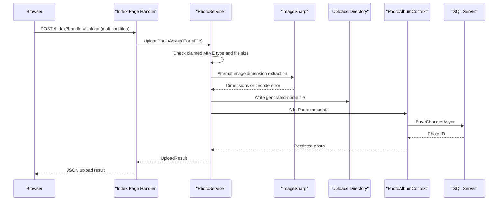

# API & Service Communication Contracts

PhotoAlbum exposes a small Razor Pages surface through synchronous browser HTTP requests, with asynchronous in-process calls from page handlers to the photo service. It has no separate REST service or API gateway.

## Service Catalog

| Service | Port | Category | Purpose |
|---|---|---|---|
| PhotoAlbum | 8080 in container; local launch profiles use 5134 and 7055 | API Layer | Serves the gallery, photo details, upload, and deletion flows |

## API Endpoints Inventory

| Service | Method | Path | Request Type | Response Type |
|---|---|---|---|---|
| PhotoAlbum | GET | `/` | None | Gallery Razor Page |
| PhotoAlbum | POST | `/Index?handler=Upload` | Multipart `files` collection and antiforgery token | JSON with upload success, uploaded photo summaries, and failed uploads |
| PhotoAlbum | GET | `/Detail/{id:int?}` | Photo ID route parameter | Photo detail Razor Page or 404 |
| PhotoAlbum | POST | `/Detail/{id:int?}?handler=Delete` | Photo ID route parameter and antiforgery token | Redirect to gallery, or redirect back with an error |
| PhotoAlbum | GET | `/photo/{id:int}` | Photo ID route parameter | Photo bytes with stored MIME type, or 404 |

There is no API versioning scheme. The upload response uses an anonymous JSON object rather than a dedicated response DTO.

## Management & Observability Endpoints

| Service | Endpoint | Custom Metrics |
|---|---|---|
| PhotoAlbum | No dedicated health, metrics, or Swagger endpoint identified | None identified |

## DTOs & Contracts

- `IFormFile` is the upload request input.
- `UploadResult` is the service-level upload outcome.
- `Photo` is the persisted domain entity used by gallery and detail pages.
- The upload handler returns anonymous JSON objects containing a subset of photo metadata; there are no dedicated immutable API DTOs.
- ASP.NET Core uses its default JSON serialization behavior for the upload response. No OpenAPI/Swagger, protobuf, or GraphQL contract was found.

## Communication Patterns

The browser communicates with the Razor Pages application over HTTP(S). Page models call `IPhotoService` directly within the same process; `PhotoService` asynchronously uses EF Core and local filesystem APIs. There are no message queues, external HTTP clients, service discovery, gateway aggregation, retry policies, circuit breakers, or client-side load balancing.

HTTPS redirection is configured. Upload and delete forms include antiforgery tokens, but no authentication or authorization policy is configured; the page endpoints are otherwise publicly accessible. The production deployment template uses a managed identity connection string for Azure SQL, while file persistence in application code remains local.

## Service Technology Matrix

| Service | Web | Data Access | Discovery | Gateway | Health | Cache | Metrics |
|---|---|---|---|---|---|---|---|
| PhotoAlbum | ASP.NET Core Razor Pages | EF Core 9 / SQL Server | None | None | No dedicated health check | None identified | None identified |

## Service Communication Sequence

