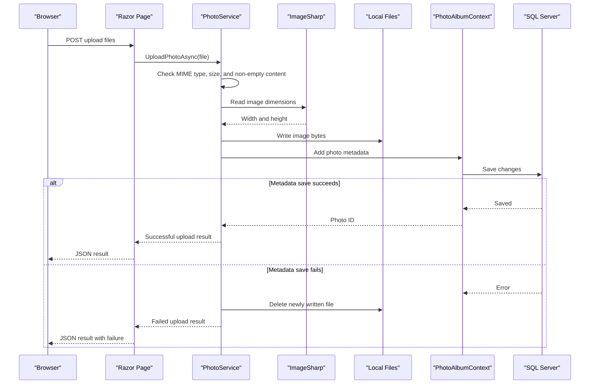

# API & Service Communication Contracts

The application exposes server-rendered Razor Page routes and one JSON upload handler; it has no separately deployed service-to-service APIs. All application operations are in-process calls through `IPhotoService`.

## Service Catalog

| Service | Port | Category | Purpose |
|---|---|---|---|
| PhotoAlbum | 5134 (HTTP), 7055 (HTTPS launch profile) | API Layer / Web | Serves the gallery, photo details, uploads, image files, and deletion |

## API Endpoints Inventory

| Service | Method | Path | Request Type | Response Type |
|---|---|---|---|---|
| PhotoAlbum | GET | `/` | None | Gallery Razor Page |
| PhotoAlbum | POST | `/?handler=Upload` | Multipart `files` collection | JSON upload results; 400 if no files |
| PhotoAlbum | GET | `/Detail/{id?}` | Optional route ID | Detail Razor Page; 404 if missing |
| PhotoAlbum | POST | `/Detail/{id?}?handler=Delete` | Route `id` | Redirect to gallery or detail page |
| PhotoAlbum | GET | `/photo/{id:int}` | Route `id` | Image bytes with stored MIME type; 404 if missing, 500 on error |
| PhotoAlbum | GET | `/Privacy` | None | Privacy Razor Page |
| PhotoAlbum | GET | `/Error` | None | Error Razor Page |

## Management & Observability Endpoints

| Service | Endpoint | Custom Metrics |
|---|---|---|
| PhotoAlbum | None identified | None identified |

No health-check or Swagger endpoints are registered.

## DTOs & Contracts

`Photo` is the persisted domain entity returned to page handlers; `UploadResult` reports individual upload success, identifier, filename, and error details. The upload handler builds an anonymous JSON response with uploaded-photo summaries and failed-upload details. No OpenAPI, protobuf, or GraphQL contract was found. ASP.NET Core serializes the upload JSON response using its configured JSON formatter.

## Communication Patterns

Browser-to-app communication is synchronous HTTP. Page handlers make direct asynchronous method calls to the scoped `IPhotoService`, which accesses EF Core and the local filesystem; there are no message brokers, service discovery, API gateway, retries, or circuit breakers. Authentication and role-based authorization are not registered. HTTPS redirection is enabled and HSTS is used outside Development; no external TLS termination or API authentication configuration is present.

## Service Technology Matrix

| Service | Web | Data Access | Discovery | Gateway | Actuator | Cache | Metrics |
|---|---|---|---|---|---|---|---|
| PhotoAlbum | Razor Pages | EF Core / SQL Server | None | None | None | HTTP response caching for static and photo files | None identified |

## Service Communication Sequence

