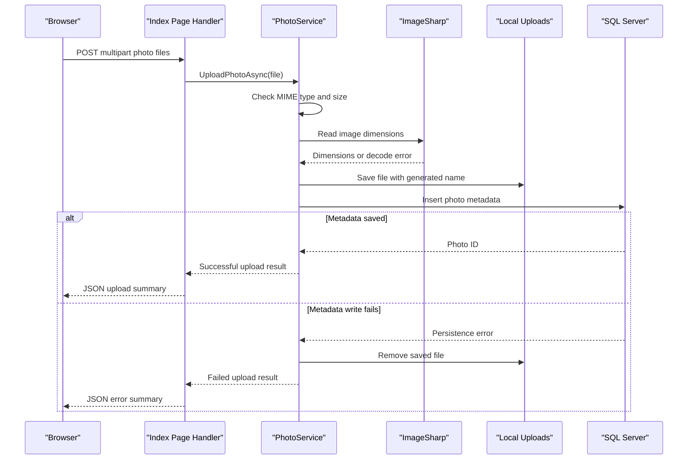

# API & Service Communication Contracts

The application exposes Razor Page request handlers for the gallery, upload, photo detail, and photo-file flows. Requests are handled synchronously within one application process; no inter-service API or asynchronous messaging is configured.

## Service Catalog

| Service | Port | Category | Purpose |
|---|---|---|---|
| PhotoAlbum | 5134 HTTP / 7055 HTTPS (development launch profile) | API Layer | Serves the gallery and manages uploaded photo records and files |

## API Endpoints Inventory

| Service | Method | Path | Request Type | Response Type |
|---|---|---|---|---|
| PhotoAlbum | GET | `/` | None | Rendered gallery page |
| PhotoAlbum | POST | `/Index?handler=Upload` | Multipart form with `List<IFormFile>` and antiforgery token | JSON with upload status, successful photo metadata, and failures |
| PhotoAlbum | GET | `/Detail?id={id}` | Integer query parameter `id` | Rendered photo detail page or 404 |
| PhotoAlbum | POST | `/Detail?handler=Delete&id={id}` | Integer `id` and antiforgery token | Redirect to gallery or detail page |
| PhotoAlbum | GET | `/PhotoFile?id={id}` | Integer query parameter `id` | Photo bytes with stored MIME type, or 404 |
| PhotoAlbum | GET | `/Privacy` | None | Rendered privacy page |

No API versioning scheme is configured.

## Management & Observability Endpoints

| Service | Endpoint | Custom Metrics |
|---|---|---|
| PhotoAlbum | No health-check, Swagger, or metrics endpoints detected | None detected |

## DTOs & Contracts

`Photo` is the service-level entity used for persisted photo metadata and returned by service lookup methods. `UploadResult` reports the outcome of an upload. The upload page handler creates an anonymous JSON response rather than using a dedicated request/response DTO. No gateway aggregation DTO, OpenAPI specification, protobuf schema, or GraphQL schema was detected. ASP.NET Core uses its built-in JSON serialization for the upload response.

## Communication Patterns

All application communication is synchronous: browser requests invoke Razor Page handlers, which call `IPhotoService`, which then uses EF Core and the local filesystem. There are no message brokers, service discovery, gateway composition, retry policies, circuit breakers, or configured downstream timeouts. Startup applies EF migrations before request handling unless the test-environment flag is enabled.

HTTPS redirection is configured and HSTS is enabled outside Development; deployment TLS termination is not defined in the repository. No authentication scheme or authorization policy is configured. Authorization middleware is present, and Razor Pages form posts use antiforgery tokens, but these do not provide user authentication or role-based access control.

## Service Technology Matrix

| Service | Web | Data Access | Discovery | Gateway | Actuator | Cache | Metrics |
|---|---|---|---|---|---|---|---|
| PhotoAlbum | Razor Pages | EF Core SQL Server | None | None | None | None | None |

## Service Communication Sequence

