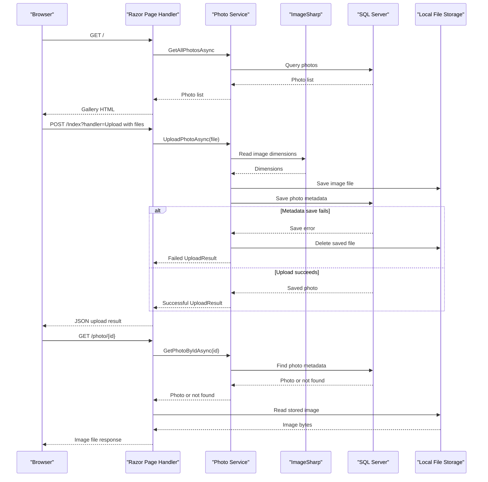

# API & Service Communication Contracts

PhotoAlbum exposes four Razor Page request handlers for gallery, upload, detail, and photo-file operations. Requests are handled synchronously through page handlers and an in-process photo service; no inter-service API or asynchronous messaging is configured.

## Service Catalog

| Service | Port | Category | Purpose |
|---|---|---|---|
| PhotoAlbum | Not configured in project files | API Layer | Serves the gallery and handles photo upload, display, and deletion |

The solution also contains `PhotoAlbum.Tests`, which is a test project rather than an independently deployable service.

## API Endpoints Inventory

| Service | Method | Path | Request Type | Response Type |
|---|---|---|---|---|
| PhotoAlbum | GET | `/` | No body | Gallery Razor Page; photo list |
| PhotoAlbum | POST | `/Index?handler=Upload` | Multipart form with `files` | JSON upload result; 400 when no files are supplied |
| PhotoAlbum | GET | `/Detail/{id?}` | Optional route parameter `id` | Detail Razor Page; 404 when the photo is absent |
| PhotoAlbum | POST | `/Detail/{id?}?handler=Delete` | Route parameter `id` | Redirect to gallery or back to detail on error |
| PhotoAlbum | GET | `/photo/{id}` | Required route parameter `id` | Image file; 404 when photo/file is missing, 500 on unexpected error |

The project does not define a separate API versioning scheme.

## Management & Observability Endpoints

| Service | Endpoint | Custom Metrics |
|---|---|---|
| PhotoAlbum | No health-check, Swagger, or custom metrics endpoint identified | None identified |

## DTOs & Contracts

`UploadResult` is the service-level upload outcome returned by `IPhotoService`; the upload page handler projects successful and failed outcomes into an anonymous JSON response. `Photo` is the domain entity used as gallery and detail page data and is not an immutable API DTO. No dedicated request/response DTOs, OpenAPI/Swagger specification, protobuf schema, or GraphQL schema were identified. ASP.NET Core's default JSON serialization is used for the upload response.

## Communication Patterns

The browser communicates with Razor Page handlers over HTTP. Page models call `IPhotoService` through direct in-process method calls; `PhotoService` accesses SQL Server through EF Core and reads/writes local files. No service discovery, gateway aggregation, message broker, circuit breaker, retry policy, or explicit timeout policy was identified. HTTPS redirection is configured, but no API authentication or role-based authorization policy is configured.

## Service Technology Matrix

| Service | Web | Data Access | Discovery | Gateway | Actuator | Cache | Metrics |
|---|---|---|---|---|---|---|---|
| PhotoAlbum | Razor Pages | EF Core SQL Server | None | None | None | None identified | None identified |

## Service Communication Sequence

