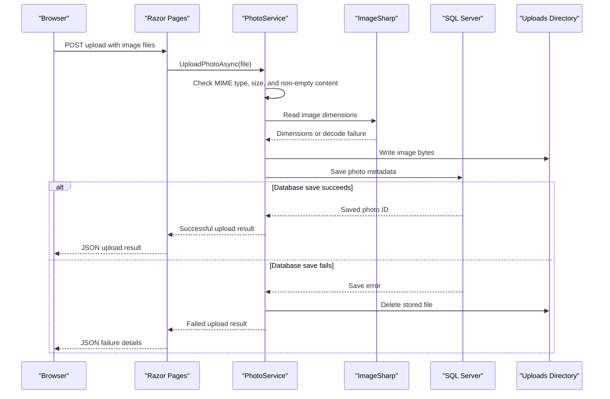

# API & Service Communication Contracts

The application exposes a small synchronous HTTP surface through Razor Page handlers and a photo-file route. It has one deployable application service and does not configure inter-service messaging or a separate API gateway.

## Service Catalog

| Service | Port | Category | Purpose |
|---|---|---|---|
| PhotoAlbum | 8080 in container; 5134/7055 locally | API Layer | Serves the photo gallery, upload and deletion flows, and photo content |

## API Endpoints Inventory

| Service | Method | Path | Request Type | Response Type |
|---|---|---|---|---|
| PhotoAlbum | GET | `/` | None | Razor gallery page; photo list |
| PhotoAlbum | POST | `/?handler=Upload` | Multipart `List<IFormFile>` | JSON upload results; 400 when no files are supplied |
| PhotoAlbum | GET | `/Detail/{id:int?}` | Optional route `id` | Razor detail page; 404 when missing |
| PhotoAlbum | POST | `/Detail/{id:int?}?handler=Delete` | Route `id` | Redirect to gallery; failure redirects back to detail |
| PhotoAlbum | GET | `/photo/{id:int}` | Route `id` | Image bytes with stored MIME type; 404 if missing; 500 on an unexpected read failure |

## Management & Observability Endpoints

| Service | Endpoint | Custom Metrics (if any) |
|---|---|---|
| PhotoAlbum | None identified | None identified |

No health-check endpoint, Swagger UI, or metrics exporter is configured.

## DTOs & Contracts

`Photo` is the persisted domain entity used by page models and views. Upload responses are projected as anonymous JSON objects from `IndexModel`; `UploadResult` carries the service-level upload status and photo identifier. No dedicated immutable request/response records, gateway aggregation DTOs, OpenAPI specification, protobuf schema, or GraphQL schema were identified. JSON uses the ASP.NET Core defaults.

## Communication Patterns

All page-to-service operations are in-process, synchronous method calls with asynchronous I/O for database and file work. There are no service-to-service HTTP clients, message brokers, retries, circuit breakers, service discovery, or client-side load balancing. Database availability is needed for persisted metadata, and startup applies EF migrations unless test mode is enabled. HTTPS redirection is configured; no authentication scheme or resource-level authorization policy is registered, so the page routes are publicly accessible by default.

## Service Technology Matrix

| Service | Web | Data Access | Discovery | Gateway | Actuator | Cache | Metrics |
|---|---|---|---|---|---|---|---|
| PhotoAlbum | Razor Pages | EF Core / SQL Server | None | None | None | None | None |

## Service Communication Sequence

