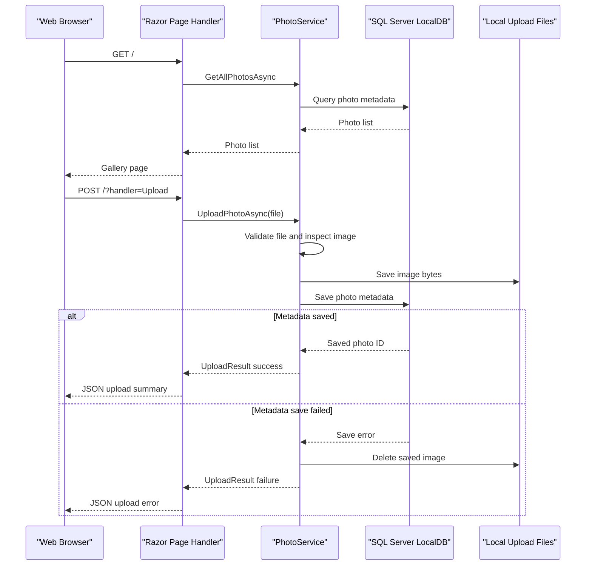

# API & Service Communication Contracts

PhotoAlbum exposes server-rendered Razor Page routes and page handlers, including a JSON upload-handler response and a photo-file response. Communication is synchronous within the application; no separate backend services or asynchronous messaging are configured.

## Service Catalog

| Service | Port | Category | Purpose |
|---|---|---|---|
| PhotoAlbum | Not declared in project configuration | API Layer | Serves the photo gallery, upload and deletion handlers, detail pages, and photo files |

## API Endpoints Inventory

| Service | Method | Path | Request Type | Response Type |
|---|---|---|---|---|
| PhotoAlbum | GET | `/` | None | Gallery Razor Page |
| PhotoAlbum | POST | `/?handler=Upload` | Multipart `List<IFormFile>` | JSON upload summary; 400 if no files are supplied |
| PhotoAlbum | GET | `/Detail/{id?}` | Optional integer route parameter `id` | Detail Razor Page; 404 if photo is missing |
| PhotoAlbum | POST | `/Detail/{id?}?handler=Delete` | Integer `id` form/route parameter | Redirect to `/Index`; on error redirects back with a message |
| PhotoAlbum | GET | `/photo/{id:int}` | Integer route parameter `id` | Image file; 404 if metadata or file is missing; 500 on an unexpected error |

The application uses conventional Razor Pages routing and has no explicit API versioning scheme.

## Management & Observability Endpoints

| Service | Endpoint | Custom Metrics |
|---|---|---|
| PhotoAlbum | No health-check, Swagger/OpenAPI, or metrics endpoint configured | None detected |

## DTOs & Contracts

`UploadResult` represents the internal outcome of a service upload operation. The upload page handler returns an anonymous JSON projection for successful uploads and upload errors; it is not declared as a dedicated DTO. `Photo` is the service-level domain entity used by the gallery and detail pages, and is also the metadata source for the photo-file response. These classes are mutable; no immutable request or response records, gateway-level DTOs, OpenAPI specification, protobuf schema, or GraphQL schema were found. JSON uses ASP.NET Core's default System.Text.Json serialization.

## Communication Patterns

Page handlers call `IPhotoService` directly in-process. `PhotoService` uses EF Core for metadata operations and local filesystem operations for image bytes; there are no inter-service HTTP calls, message brokers, asynchronous event flows, service discovery, API gateway aggregation, or configured retry/circuit-breaker policies.

HTTPS redirection is enabled and HSTS is enabled outside Development. No authentication scheme or endpoint-specific authorization policy is configured. The authorization middleware is present in the request pipeline.

## Service Technology Matrix

| Service | Web | Data Access | Discovery | Gateway | Actuator | Cache | Metrics |
|---|---|---|---|---|---|---|---|
| PhotoAlbum | Razor Pages | EF Core | None | None | None | HTTP response headers only | None |

## Service Communication Sequence

