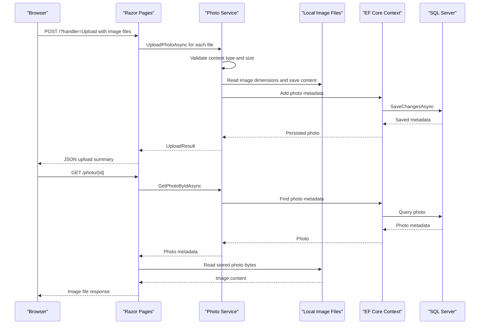

# API & Service Communication Contracts

PhotoAlbum exposes Razor Page endpoints for gallery browsing, upload, photo detail, deletion, and file retrieval. Requests are handled synchronously at the HTTP boundary and use asynchronous in-process service and database operations.

## Service Catalog

| Service | Port | Category | Purpose |
|---|---|---|---|
| PhotoAlbum | 5134 HTTP, 7055 HTTPS (local launch profiles) | API Layer | Serves the gallery pages and photo operations |

## API Endpoints Inventory

| Service | Method | Path | Request Type | Response Type |
|---|---|---|---|---|
| PhotoAlbum | GET | `/` | None | Gallery Razor Page |
| PhotoAlbum | POST | `/?handler=Upload` | Multipart `files` (`List<IFormFile>`) | JSON upload summary with successful and failed uploads |
| PhotoAlbum | GET | `/Detail/{id?}` | Optional route/query `id` | Detail Razor Page or 404 |
| PhotoAlbum | POST | `/Detail/{id?}?handler=Delete` | Route `id`, antiforgery token | Redirect to gallery or detail |
| PhotoAlbum | GET | `/photo/{id}` | Required integer route `id` | Image file or 404/500 |
| PhotoAlbum | GET | `/Error` | None | Error Razor Page |

## Management & Observability Endpoints

No health-check, metrics, management, or Swagger endpoints are configured. The `/Error` page is a user-facing error page, not a management endpoint.

## DTOs & Contracts

`Photo` is the service-level domain entity returned to page handlers and used to render detail and gallery views. Upload requests use ASP.NET Core `IFormFile`; the upload service returns `UploadResult`, while the upload page handler exposes an anonymous JSON response containing upload summaries. Razor Page handlers also return framework page, file, not-found, status-code, or redirect results. No immutable request/response DTO classes, OpenAPI specification, protobuf schema, or GraphQL schema are present. JSON uses the ASP.NET Core default serializer configuration.

## Communication Patterns

Page handlers call `IPhotoService` directly in process; the service asynchronously uses EF Core for metadata and local filesystem operations for image content. No inter-service HTTP, messaging, service discovery, gateway aggregation, retries, circuit breakers, timeouts, or client-side load balancing are configured. Startup applies database migrations before serving requests except in the explicitly flagged test environment. HTTPS redirection is configured, but no authentication or explicit authorization policy is configured; the application exposes the page operations without identity-based access control.

## Service Technology Matrix

| Service | Web | Data Access | Discovery | Gateway | Actuator | Cache | Metrics |
|---|---|---|---|---|---|---|---|
| PhotoAlbum | ASP.NET Core Razor Pages | EF Core SQL Server | None | None | None | HTTP response caching headers | None |

## Service Communication Sequence

