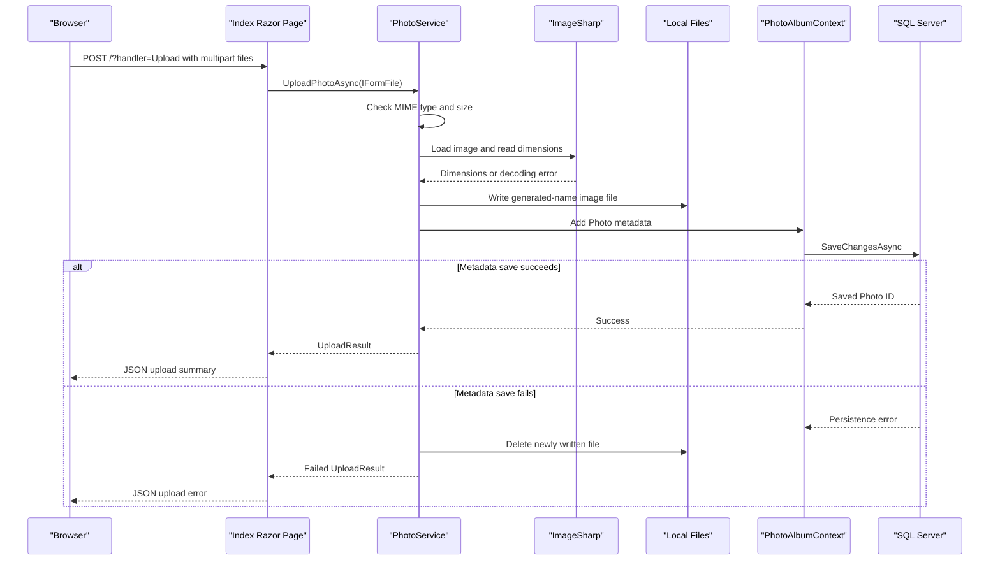

# API & Service Communication Contracts

PhotoAlbum exposes Razor Page routes and form handlers rather than a separate REST API. Requests are handled synchronously within one application and no inter-service APIs or asynchronous message channels were identified.

## Service Catalog

| Service | Port | Category | Purpose |
|---|---|---|---|
| PhotoAlbum | 5134 HTTP, 7055 HTTPS (development launch profiles) | API Layer | Serves gallery pages and handles photo operations |

## API Endpoints Inventory

| Service | Method | Path | Request Type | Response Type |
|---|---|---|---|---|
| PhotoAlbum | GET | `/` | None | Gallery Razor Page |
| PhotoAlbum | POST | `/?handler=Upload` | Multipart form, `List<IFormFile>` | JSON object containing upload successes and failures |
| PhotoAlbum | GET | `/Detail/{id?}` | Optional integer route parameter | Photo detail Razor Page or 404 |
| PhotoAlbum | POST | `/Detail/{id}?handler=Delete` | Integer route parameter | Redirect to gallery or detail page |
| PhotoAlbum | GET | `/photo/{id}` | Integer route parameter | Photo bytes with stored MIME type, or 404 |
| PhotoAlbum | GET | `/Privacy` | None | Privacy Razor Page |
| PhotoAlbum | GET | `/Error` | None | Error Razor Page |

## Management & Observability Endpoints

| Service | Endpoint | Custom Metrics |
|---|---|---|
| PhotoAlbum | No health-check or metrics endpoint is configured | None identified |

Swagger/OpenAPI is not configured.

## DTOs & Contracts

`Photo` is the persisted domain entity used by gallery and detail views. `UploadResult` is the mutable service result containing success state, optional photo ID, original filename, and user-facing error text. The upload page serializes an anonymous response object with uploaded-photo summaries and failed-upload details. No gateway DTOs, OpenAPI documents, protobuf schemas, or GraphQL schemas were found. ASP.NET Core's default JSON serialization handles the upload response.

## Communication Patterns

Page handlers invoke `IPhotoService` directly; `PhotoService` uses `PhotoAlbumContext` for EF Core operations and local filesystem APIs for image bytes. The HTTP interaction is synchronous request/response; no queues, service discovery, gateway aggregation, retry policy, or circuit breaker is configured.

HTTPS redirection is enabled in the application pipeline. Authentication services and explicit authorization policies are not registered; the authorization middleware is present, but no user authentication or role-based authorization was found. POST forms include antiforgery tokens. Startup creates the uploads directory and applies database migrations before the application begins serving requests.

## Service Technology Matrix

| Service | Web | Data Access | Discovery | Gateway | Actuator | Cache | Metrics |
|---|---|---|---|---|---|---|---|
| PhotoAlbum | Razor Pages | EF Core SQL Server | None | None | None | Static-file response caching only | None |

## Service Communication Sequence

