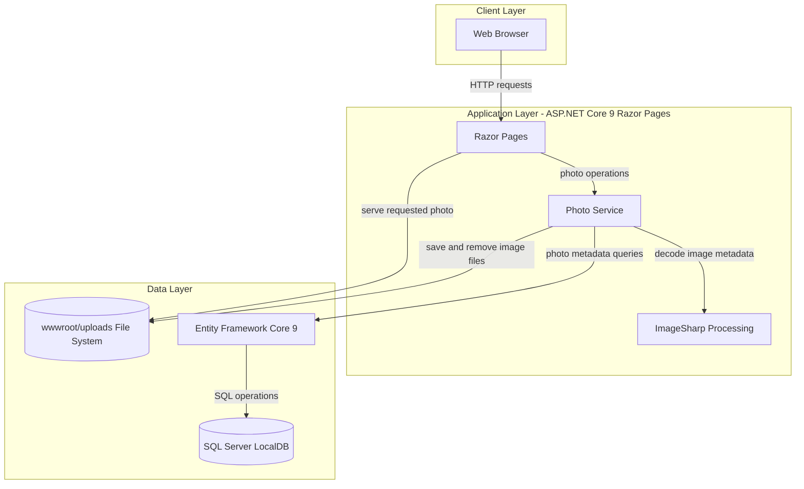
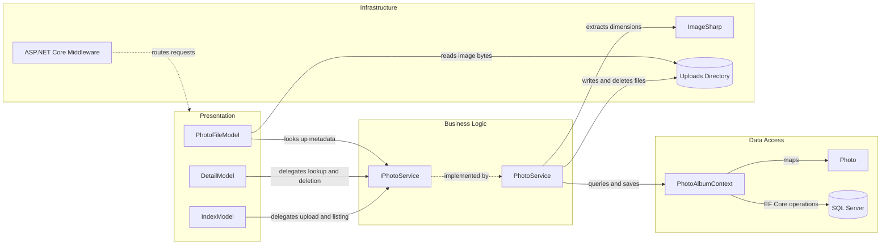

# Architecture Diagram

PhotoAlbum is a single ASP.NET Core Razor Pages application with a service layer, EF Core persistence, and local file storage for image content. The solution also contains a separate test project.

## Application Architecture

### Technology Stack Summary

| Layer | Technology | Version | Purpose |
|---|---|---:|---|
| Presentation | ASP.NET Core Razor Pages | 9.0 | Server-rendered gallery, detail, upload, and photo-file requests |
| Business Logic | PhotoService | Application code | Validates uploads and coordinates file and metadata operations |
| Image Processing | SixLabors.ImageSharp | 3.1.11 | Reads image dimensions and validates image decoding |
| Data Access | Entity Framework Core | 9.0.9 | Persists photo metadata |
| Database | SQL Server LocalDB | configured | Stores photo metadata during local development |
| File Storage | Local file system | N/A | Stores uploaded image bytes under `wwwroot/uploads` |

### Data Storage & External Services

Photo metadata is stored in SQL Server through EF Core; uploaded bytes are stored separately in the local uploads directory. The application does not configure a cache, message broker, or external runtime API integration. Deployment templates can provide a SQL Server connection through environment configuration.

### Key Architectural Decisions

- `IPhotoService` separates photo operations from Razor Pages and allows storage implementation changes.
- Upload coordinates file persistence and database persistence, deleting the stored file if metadata persistence fails.
- The application uses a database migration at startup except when `IsTestEnvironment` is enabled.

## Component Relationships

### Component Inventory

| Component | Layer | Type | Responsibility |
|---|---|---|---|
| IndexModel | Presentation | Razor Page model | Lists photos and handles upload requests |
| DetailModel | Presentation | Razor Page model | Displays photo details and handles deletion |
| PhotoFileModel | Presentation | Razor Page model | Retrieves and serves stored image bytes by photo ID |
| IPhotoService | Business Logic | Service interface | Defines photo listing, lookup, upload, and deletion operations |
| PhotoService | Business Logic | Service | Validates and processes uploads; coordinates database and file operations |
| PhotoAlbumContext | Data Access | EF Core DbContext | Maps photo metadata and queries the database |
| Photo | Data Access | Entity | Represents persisted photo metadata |
| ImageSharp | Infrastructure | Image library | Reads image dimensions during upload |
