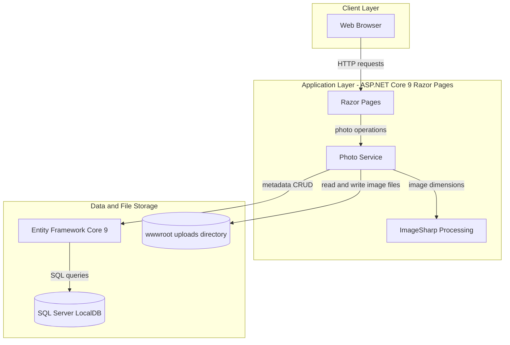
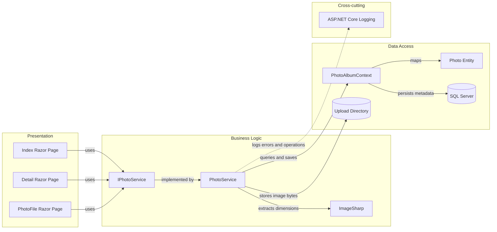

# Architecture Diagram

PhotoAlbum is a server-rendered photo gallery with a single web application and no separately deployed services. Photo metadata is stored in SQL Server, while image files are stored on the local filesystem.

## Application Architecture

### Technology Stack Summary

| Layer | Technology | Version | Purpose |
|---|---|---:|---|
| Presentation | ASP.NET Core Razor Pages | 9.0 | Server-rendered gallery and photo pages |
| Business logic | PhotoService / ImageSharp | 3.1.11 | Upload, retrieval, deletion, and image dimension extraction |
| Persistence | Entity Framework Core / SQL Server provider | 9.0.9 | Persist photo metadata |
| File storage | Local filesystem | — | Store image bytes under the configured upload directory |

### Data Storage & External Services

The app uses SQL Server LocalDB for photo metadata and local disk for image content. It does not declare external APIs, caches, or message brokers; ImageSharp processes uploaded images in-process.

### Key Architectural Decisions

- `IPhotoService` separates page handlers from photo operations and storage implementation.
- Upload writes the image file and then persists metadata, deleting the file if the database save fails.
- Database migrations run during startup except when the `IsTestEnvironment` setting is enabled.

## Component Relationships

### Component Inventory

| Component | Layer | Type | Responsibility |
|---|---|---|---|
| Index | Presentation | Razor Page | Displays the gallery and handles photo uploads |
| Detail | Presentation | Razor Page | Displays a photo and handles deletion |
| PhotoFile | Presentation | Razor Page | Serves an image file by photo ID |
| IPhotoService | Business Logic | Service interface | Defines photo retrieval, upload, and deletion operations |
| PhotoService | Business Logic | Service | Validates uploads and coordinates image, file, and metadata operations |
| PhotoAlbumContext | Data Access | EF Core DbContext | Maps photo metadata to SQL Server |
| Photo | Data Access | Entity | Represents stored photo metadata |
