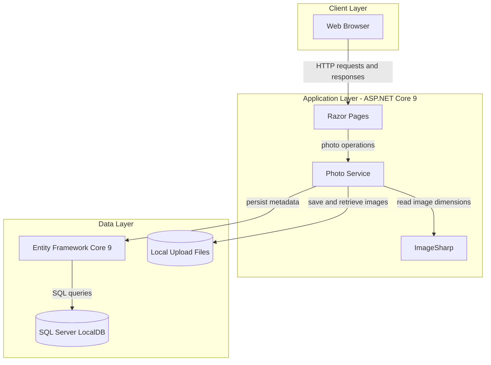
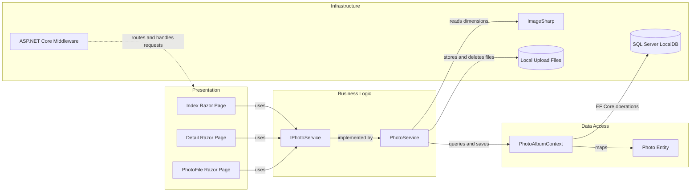

# Architecture Diagram

PhotoAlbum is a server-rendered photo gallery built with ASP.NET Core Razor Pages. The application uses a relational database for photo metadata and local disk storage for image files.

## Application Architecture

### Technology Stack Summary

| Layer | Technology | Version | Purpose |
|---|---|---|---|
| Presentation | ASP.NET Core Razor Pages | 9.0 | Server-rendered gallery, upload, and photo detail pages |
| Business Logic | PhotoService | Application code | Validates uploads and coordinates metadata and file operations |
| Image Processing | SixLabors.ImageSharp | 3.1.11 | Reads image dimensions |
| Data Access | Entity Framework Core | 9.0.9 | Maps photo metadata and performs database operations |
| Database | SQL Server LocalDB | Configured instance | Stores photo metadata |
| File Storage | Local filesystem | N/A | Stores uploaded image files |

### Data Storage & External Services

Photo metadata is stored in SQL Server LocalDB through Entity Framework Core, while image bytes are saved under the configured local upload directory. ImageSharp is used for dimension extraction; no cache, message broker, or external API integration is configured.

### Key Architectural Decisions

- Razor Pages provide the server-side presentation layer and delegate photo operations to an injected service.
- `IPhotoService` abstracts photo operations, while `PhotoService` coordinates file storage, image processing, and database persistence.
- Upload configuration controls size, MIME types, and the local storage path.

## Component Relationships

### Component Inventory

| Component | Layer | Type | Responsibility |
|---|---|---|---|
| Index Razor Page | Presentation | Razor Page | Displays the gallery and accepts photo uploads |
| Detail Razor Page | Presentation | Razor Page | Displays photo details and navigation |
| PhotoFile Razor Page | Presentation | Razor Page | Serves photo file content |
| IPhotoService | Business Logic | Service interface | Defines photo retrieval, upload, and deletion operations |
| PhotoService | Business Logic | Service | Validates uploads and coordinates image, file, and metadata operations |
| PhotoAlbumContext | Data Access | EF Core DbContext | Maps and queries photo metadata |
| Photo | Data Access | Entity | Represents persisted photo metadata |
| ASP.NET Core Middleware | Infrastructure | Request pipeline | Handles routing, static files, HTTPS redirection, and authorization |
| ImageSharp | Infrastructure | Image library | Extracts image dimensions |
| SQL Server LocalDB | Infrastructure | Database | Persists photo metadata |
| Local Upload Files | Infrastructure | Filesystem | Stores image bytes |
