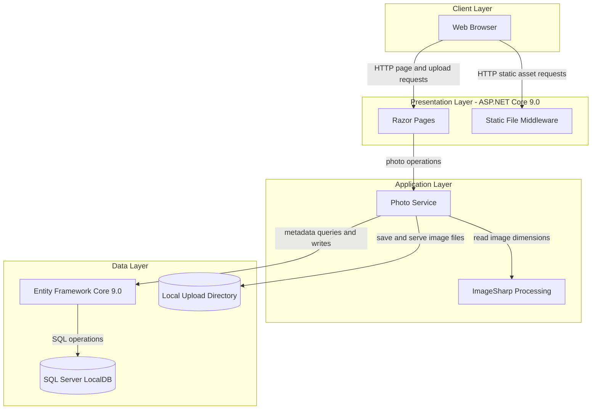
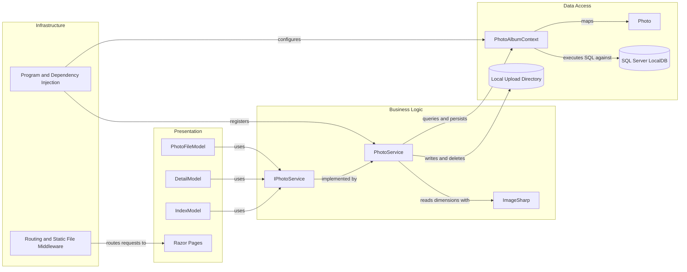

# Architecture Diagram

PhotoAlbum is an ASP.NET Core Razor Pages application for managing uploaded photos. It stores image files on the local filesystem and photo metadata in SQL Server through Entity Framework Core.

## Application Architecture

### Technology Stack Summary

| Layer | Technology | Version | Purpose |
|---|---|---|---|
| Presentation | ASP.NET Core Razor Pages | 9.0 | Server-rendered gallery, detail, upload, and file endpoints |
| Business Logic | PhotoService | Application code | Validates and processes photo upload, retrieval, and deletion |
| Image Processing | SixLabors.ImageSharp | 3.1.11 | Reads image dimensions |
| Data Access | Entity Framework Core SQL Server | 9.0.9 | Persists photo metadata |
| Database | SQL Server LocalDB | Configured by connection string | Stores photo metadata |
| File Storage | Local filesystem | N/A | Stores uploaded image files under `wwwroot/uploads` |

### Data Storage & External Services

Photo metadata is stored in SQL Server LocalDB, while image bytes are stored in the application's local upload directory. The application does not configure external APIs, caches, or message brokers.

### Key Architectural Decisions

- Razor Page models depend on `IPhotoService`, which separates page handling from photo operations.
- Entity Framework Core provides database access through a scoped `PhotoAlbumContext`.
- Uploaded files use generated GUID-based names, while original names and image metadata are retained in the database.

## Component Relationships

### Component Inventory

| Component | Layer | Type | Responsibility |
|---|---|---|---|
| IndexModel | Presentation | Razor Page model | Lists photos and handles upload requests |
| DetailModel | Presentation | Razor Page model | Displays photo metadata and handles deletion |
| PhotoFileModel | Presentation | Razor Page model | Serves stored photo files by photo ID |
| IPhotoService | Business Logic | Service interface | Defines photo retrieval, upload, and deletion operations |
| PhotoService | Business Logic | Service | Validates uploads and coordinates image processing, file storage, and metadata persistence |
| PhotoAlbumContext | Data Access | EF Core DbContext | Maps and persists photo metadata |
| Photo | Data Access | Entity | Represents photo metadata |
| Program | Infrastructure | Application startup | Registers services, configures middleware, and applies database migrations |
