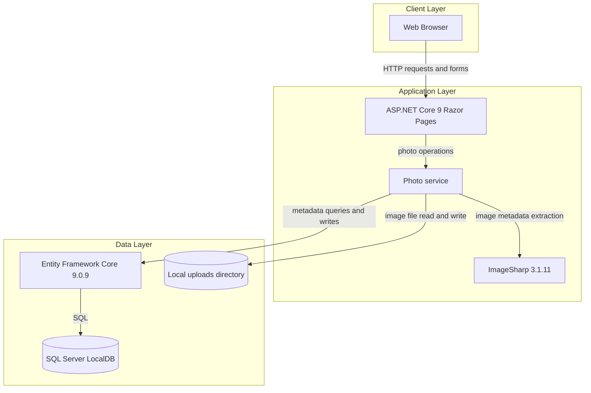
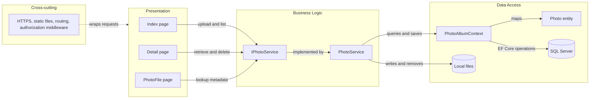

# Architecture Diagram

PhotoAlbum is a single deployable web application for uploading, browsing, and deleting photos. Its page handlers call a scoped photo service that coordinates SQL metadata and local image files.

## Application Architecture

### Technology Stack Summary

| Layer | Technology | Version | Purpose |
|---|---|---|---|
| Presentation | ASP.NET Core Razor Pages | .NET 9 | Server-rendered gallery and photo pages |
| Business Logic | PhotoService | Application code | Upload validation, image handling, metadata and file operations |
| Persistence | Entity Framework Core with SQL Server provider | 9.0.9 | Photo metadata persistence and migrations |
| Image Processing | SixLabors.ImageSharp | 3.1.11 | Image dimension extraction |
| Storage | SQL Server LocalDB and local filesystem | Configured locally | Metadata and uploaded image bytes |

### Data Storage & External Services

Photo metadata is stored in SQL Server using the configured `DefaultConnection`; uploads are saved under the configured local uploads directory. No cache, message broker, or remote service integration is configured.

### Key Architectural Decisions

- Razor Page handlers use the `IPhotoService` abstraction for photo operations.
- The service persists image files and relational metadata separately, deleting the saved file if the metadata write fails.
- Entity Framework migrations are applied during startup except when `IsTestEnvironment` is enabled.

## Component Relationships

### Component Inventory

| Component | Layer | Type | Responsibility |
|---|---|---|---|
| Index page | Presentation | Razor Page | Lists photos and handles multi-file uploads |
| Detail page | Presentation | Razor Page | Displays photo metadata and handles deletion |
| PhotoFile page | Presentation | Razor Page | Retrieves and returns photo bytes by database ID |
| IPhotoService | Business Logic | Service interface | Defines photo listing, lookup, upload, and deletion operations |
| PhotoService | Business Logic | Scoped service | Applies upload checks and coordinates file and metadata operations |
| PhotoAlbumContext | Data Access | EF Core DbContext | Maps Photo records and provides the Photos set |
| Photo | Data Access | Entity | Represents photo metadata persisted in SQL Server |
| Request middleware | Cross-cutting | ASP.NET Core middleware | Applies HTTPS redirection, static-file handling, routing, and authorization middleware |
