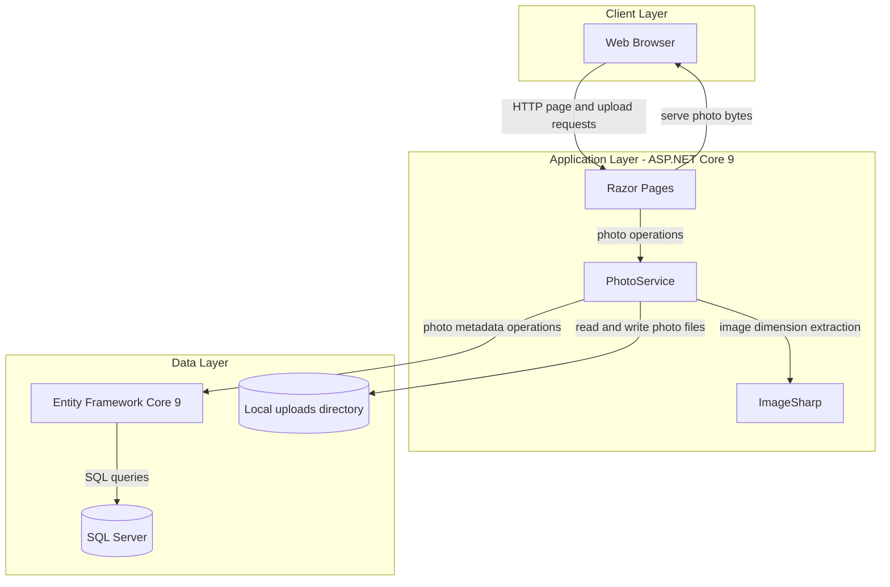
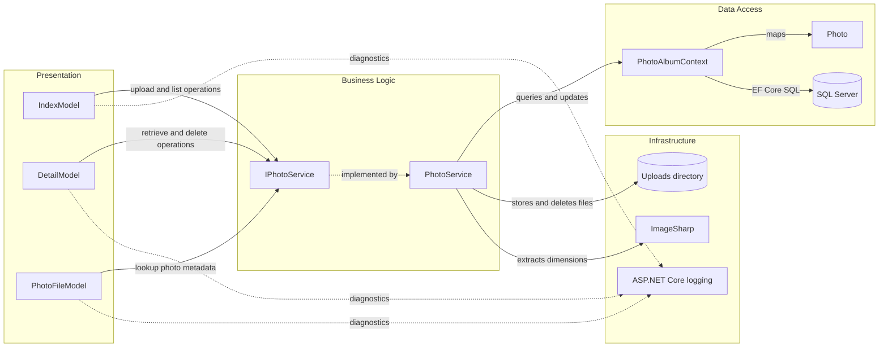

# Architecture Diagram

PhotoAlbum is a server-rendered photo gallery with upload, retrieval, and deletion flows. Its application code uses a single web application, a photo service, Entity Framework Core, SQL Server, and local file storage.

## Application Architecture

### Technology Stack Summary

| Layer | Technology | Version | Purpose |
|---|---|---:|---|
| Presentation | ASP.NET Core Razor Pages | 9.0 | Server-rendered gallery and detail pages |
| Business logic | C# PhotoService | .NET 9.0 | Upload validation, photo operations, and file management |
| Image processing | SixLabors.ImageSharp | 3.1.11 | Image dimension extraction |
| Data access | Entity Framework Core SQL Server provider | 9.0.9 | Photo metadata persistence |
| Database | SQL Server | LocalDB in development; Azure SQL in deployment configuration | Store photo metadata |
| File storage | Local filesystem | N/A | Store uploaded photo files under `wwwroot/uploads` |

### Data Storage & External Services

The application persists photo metadata in SQL Server and stores photo content in a local uploads directory. The deployment templates provision Azure SQL and Azure Blob Storage, but the application code currently saves files to the local filesystem and does not use a blob-storage client.

### Key Architectural Decisions

- Razor Page models delegate photo operations through the `IPhotoService` abstraction.
- `PhotoService` coordinates EF Core persistence and local file operations, deleting a saved file if metadata persistence fails.
- EF Core migrations are applied during startup except when the test-environment flag is enabled.

## Component Relationships

### Component Inventory

| Component | Layer | Type | Responsibility |
|---|---|---|---|
| IndexModel | Presentation | Razor Page model | Lists photos and handles multipart uploads |
| DetailModel | Presentation | Razor Page model | Displays one photo and handles deletion/navigation |
| PhotoFileModel | Presentation | Razor Page model | Returns photo bytes by photo ID |
| IPhotoService | Business Logic | Service interface | Defines photo retrieval, upload, and deletion operations |
| PhotoService | Business Logic | Scoped service | Validates uploads and coordinates image, file, and database operations |
| PhotoAlbumContext | Data Access | EF Core DbContext | Maps and persists photo metadata |
| Photo | Data Access | Entity | Represents photo metadata |
| ImageSharp | Infrastructure | Image library | Reads image dimensions during upload |
| Uploads directory | Infrastructure | Local filesystem | Holds uploaded files |
