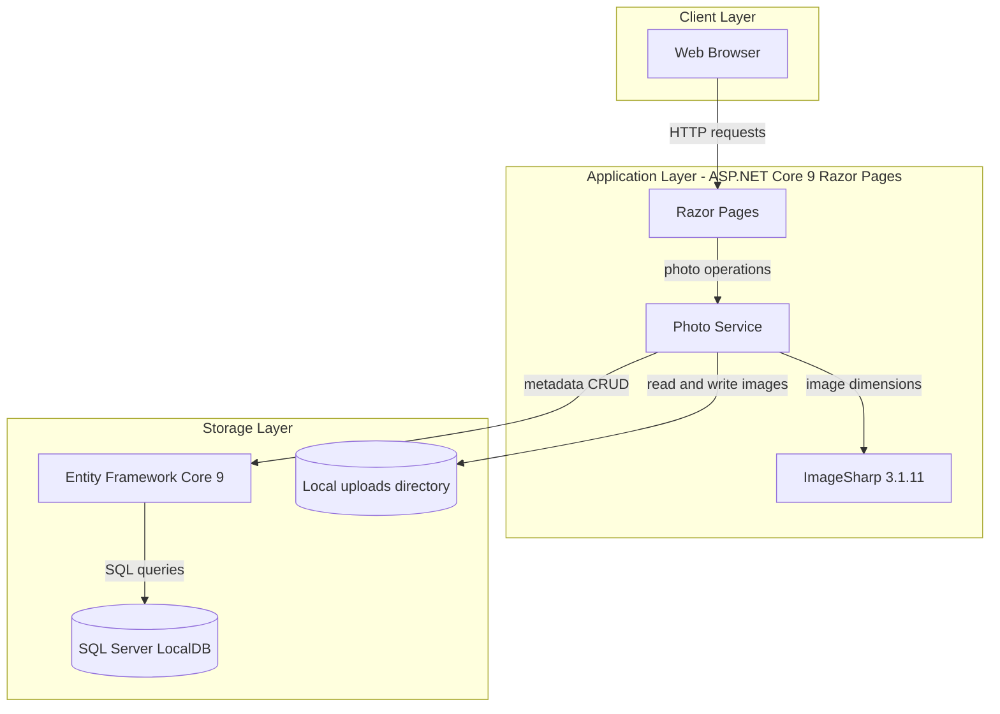
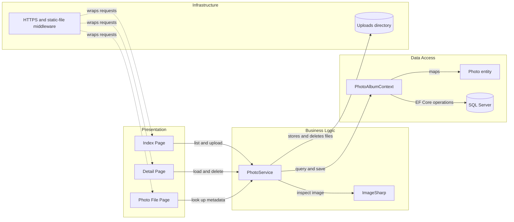

# Architecture Diagram

PhotoAlbum is a single web application that presents gallery pages and delegates photo operations to a scoped service. Photo metadata is stored in SQL Server and the photo files are stored on the local filesystem.

## Application Architecture

### Technology Stack Summary

| Layer | Technology | Version | Purpose |
|---|---|---|---|
| Presentation | ASP.NET Core Razor Pages | 9.0 | Gallery, photo details, upload, and delete interactions |
| Business logic | PhotoService | Application code | Validates uploads and coordinates metadata and file operations |
| Image processing | SixLabors.ImageSharp | 3.1.11 | Reads image dimensions during upload |
| Data access | Entity Framework Core | 9.0.9 | Persists and retrieves photo metadata |
| Database | SQL Server LocalDB | Configured by connection string | Stores the Photos entity |
| File storage | Local filesystem | — | Stores uploaded image files under the upload directory |

### Data Storage & External Services

The application stores metadata in SQL Server and stores image bytes in a local uploads directory. No external APIs, caches, or message brokers are referenced by the application.

### Key Architectural Decisions

- Razor Page handlers delegate photo operations through the `IPhotoService` abstraction.
- `PhotoService` coordinates local file operations with EF Core persistence and removes a newly written file if metadata persistence fails.
- EF Core migrations are applied during startup except when the `IsTestEnvironment` setting is true.

## Component Relationships

### Component Inventory

| Component | Layer | Type | Responsibility |
|---|---|---|---|
| Index Page | Presentation | Razor Page | Displays the gallery and accepts photo uploads |
| Detail Page | Presentation | Razor Page | Displays photo metadata and handles deletion |
| Photo File Page | Presentation | Razor Page | Retrieves photo bytes by metadata ID |
| PhotoService | Business Logic | Scoped service | Coordinates validation, image inspection, file storage, and metadata persistence |
| IPhotoService | Business Logic | Service interface | Abstracts photo operations from page handlers |
| PhotoAlbumContext | Data Access | EF Core DbContext | Maps and queries the Photos entity |
| Photo | Data Access | Entity | Represents persisted photo metadata |
| ImageSharp | Business Logic | Image-processing library | Reads image dimensions |
| Uploads directory | Infrastructure | Filesystem storage | Holds uploaded photo bytes |
| HTTPS and static-file middleware | Infrastructure | ASP.NET Core middleware | Redirects HTTPS and serves static assets |
