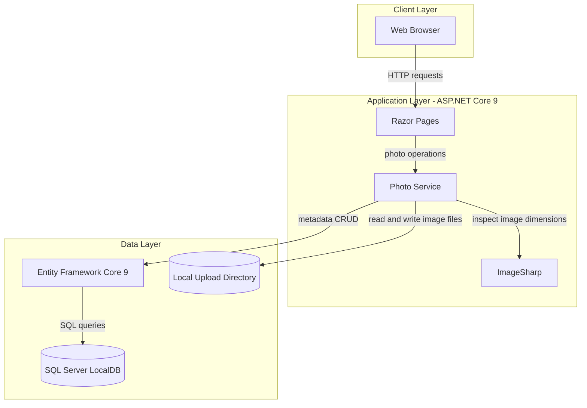
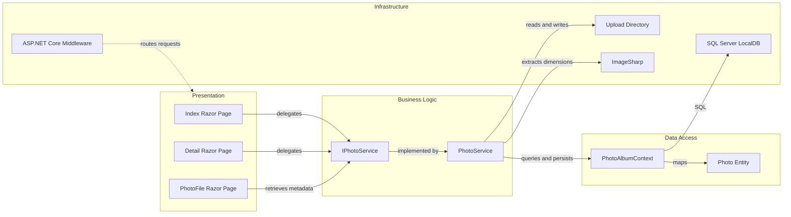

# Architecture Diagram

PhotoAlbum is a single ASP.NET Core application that serves Razor Pages and stores uploaded photos with their metadata. Its web layer delegates photo operations to a scoped service, which persists metadata through Entity Framework Core and stores file bytes on local disk.

## Application Architecture

### Technology Stack Summary

| Layer | Technology | Version | Purpose |
|---|---|---:|---|
| Presentation | ASP.NET Core Razor Pages | 9.0 | Server-rendered gallery, detail, upload, and file pages |
| Business | C# / .NET | 9.0 | Photo operation orchestration |
| Image processing | SixLabors.ImageSharp | 3.1.11 | Image dimension extraction |
| Data access | Entity Framework Core | 9.0.9 | Photo metadata persistence |
| Database | SQL Server LocalDB | Local | Relational photo metadata storage |
| File storage | Local filesystem | — | Uploaded image bytes |

### Data Storage & External Services

Photo metadata is stored in SQL Server LocalDB, while image bytes are written under `wwwroot/uploads/`. No cache, message broker, external API, or separately deployed backend service was found.

### Key Architectural Decisions

- `IPhotoService` separates page handlers from photo operations and local storage details.
- EF Core migrations manage the schema and are applied at startup except in the test environment.
- File uploads are persisted to disk, with file cleanup if metadata persistence fails.

## Component Relationships

### Component Inventory

| Component | Layer | Type | Responsibility |
|---|---|---|---|
| Index | Presentation | Razor Page | Displays gallery and accepts photo uploads |
| Detail | Presentation | Razor Page | Displays a photo and handles deletion |
| PhotoFile | Presentation | Razor Page | Returns stored photo content |
| IPhotoService | Business Logic | Service interface | Defines photo operations |
| PhotoService | Business Logic | Scoped service | Validates uploads and coordinates file and metadata operations |
| PhotoAlbumContext | Data Access | EF Core DbContext | Persists photo metadata |
| Photo | Data Access | Entity | Represents a stored photo and its metadata |
| ASP.NET Core middleware | Infrastructure | Request pipeline | Provides routing, static files, HTTPS redirection, and authorization middleware |
