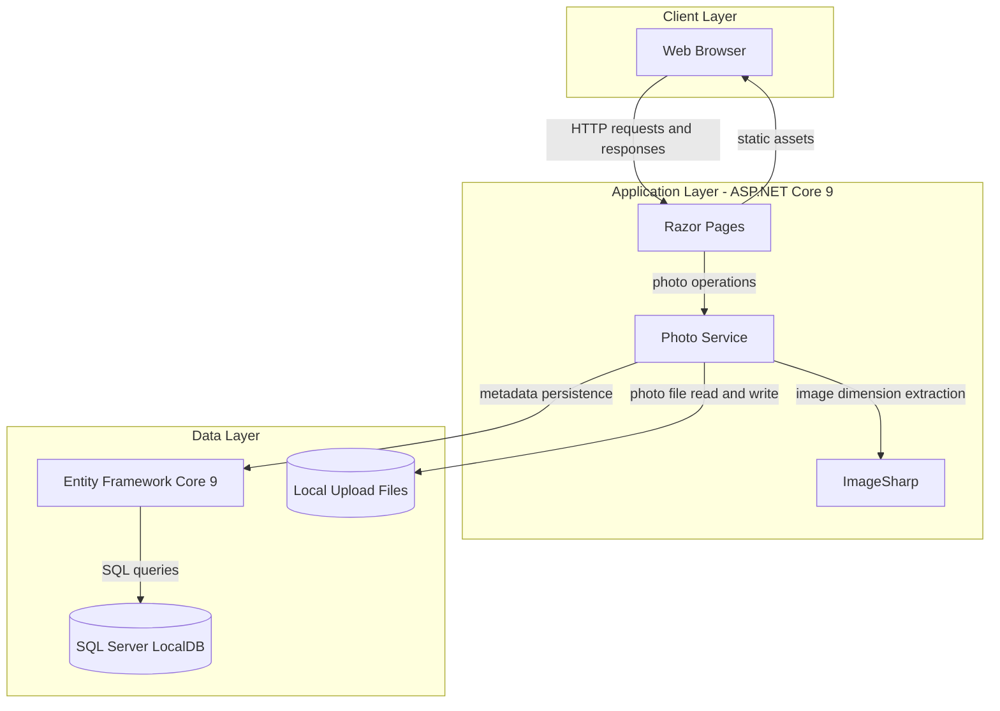
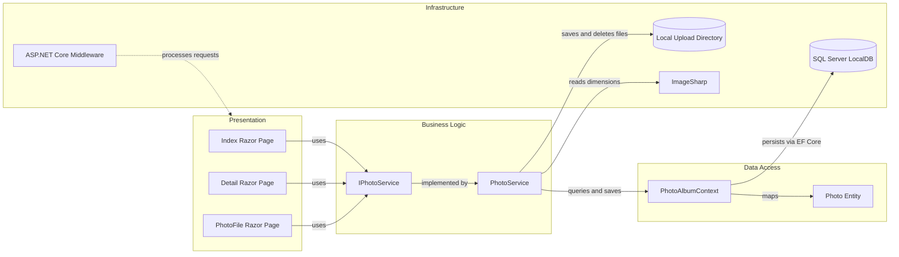

# Architecture Diagram

PhotoAlbum is an ASP.NET Core Razor Pages application for uploading, browsing, and managing photo files. The application stores photo metadata in SQL Server and photo content on the local filesystem.

## Application Architecture

### Technology Stack Summary

| Layer | Technology | Version | Purpose |
|---|---|---|---|
| Presentation | ASP.NET Core Razor Pages | 9.0 | Server-rendered gallery, detail, and file pages |
| Business Logic | PhotoService | Application code | Validates uploads, manages photo files, and coordinates metadata |
| Image Processing | SixLabors.ImageSharp | 3.1.11 | Reads image dimensions |
| Data Access | Entity Framework Core SQL Server | 9.0.9 | Persists and queries photo metadata |
| Database | SQL Server LocalDB | Configured locally | Stores photo metadata |
| File Storage | Local filesystem | N/A | Stores uploaded photo content |

### Data Storage & External Services

Photo metadata is persisted in SQL Server LocalDB through Entity Framework Core, while image files are saved beneath the configured local upload directory. ImageSharp extracts dimensions during upload. No remote database, cache, message broker, or external API is configured.

### Key Architectural Decisions

- Razor Pages provide the web UI and route operations to the photo service.
- The `IPhotoService` abstraction separates photo operations from page handlers.
- Metadata persistence uses EF Core, while uploaded content remains on local disk.

## Component Relationships

### Component Inventory

| Component | Layer | Type | Responsibility |
|---|---|---|---|
| Index Razor Page | Presentation | Razor Page | Displays the gallery and handles photo uploads |
| Detail Razor Page | Presentation | Razor Page | Displays one photo and its metadata |
| PhotoFile Razor Page | Presentation | Razor Page | Serves photo file content |
| IPhotoService | Business Logic | Service interface | Defines photo retrieval, upload, and deletion operations |
| PhotoService | Business Logic | Service | Validates uploads and coordinates file and metadata operations |
| PhotoAlbumContext | Data Access | EF Core DbContext | Maps and persists photo metadata |
| Photo | Data Access | Entity | Represents stored photo metadata |
| ASP.NET Core Middleware | Infrastructure | Middleware pipeline | Handles routing, static files, HTTPS redirection, and authorization |
