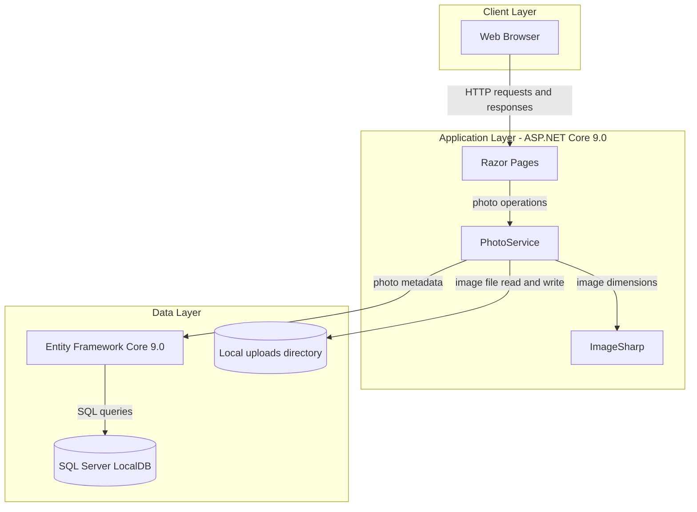
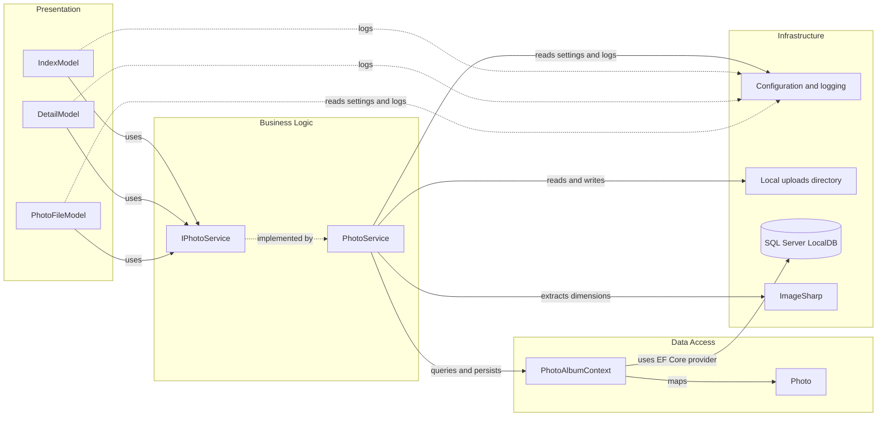

# Architecture Diagram

PhotoAlbum is an ASP.NET Core Razor Pages application that manages photo metadata in SQL Server and image files on the local filesystem.

## Application Architecture

### Technology Stack Summary

| Layer | Technology | Version | Purpose |
|---|---|---|---|
| Presentation | ASP.NET Core Razor Pages | 9.0 | Server-rendered gallery, details, and upload endpoints |
| Business logic | PhotoService | Application code | Validates and manages photo uploads, retrieval, and deletion |
| Image processing | SixLabors.ImageSharp | 3.1.11 | Reads image dimensions |
| Data access | Entity Framework Core with SQL Server provider | 9.0.9 | Persists photo metadata |
| Data storage | SQL Server LocalDB | LocalDB | Stores photo metadata |
| File storage | Local filesystem | N/A | Stores uploaded images under `wwwroot/uploads` |

### Data Storage & External Services

Photo metadata is stored in SQL Server LocalDB through Entity Framework Core, while the image binaries are stored in the application's local `wwwroot/uploads` directory. ImageSharp is used locally to inspect image dimensions; no external APIs, caches, or message brokers are configured.

### Key Architectural Decisions

- Razor Pages handle HTTP interactions and delegate photo operations through the `IPhotoService` abstraction.
- `PhotoService` coordinates filesystem operations and EF Core persistence, deleting a newly written file if metadata persistence fails.
- Configuration supplies upload limits, allowed MIME types, storage path, and the database connection string.

## Component Relationships

### Component Inventory

| Component | Layer | Type | Responsibility |
|---|---|---|---|
| IndexModel | Presentation | Razor Page model | Lists photos and handles multi-file uploads |
| DetailModel | Presentation | Razor Page model | Displays photo details and handles deletion |
| PhotoFileModel | Presentation | Razor Page model | Serves a stored image by photo ID |
| IPhotoService | Business Logic | Service interface | Defines photo retrieval, upload, and deletion operations |
| PhotoService | Business Logic | Service | Validates uploads and coordinates image, file, and metadata operations |
| PhotoAlbumContext | Data Access | EF Core DbContext | Maps and queries photo metadata |
| Photo | Data Access | Entity | Represents photo metadata persisted in the database |
| Program | Infrastructure | Application startup | Registers Razor Pages, services, database, and HTTP pipeline |
