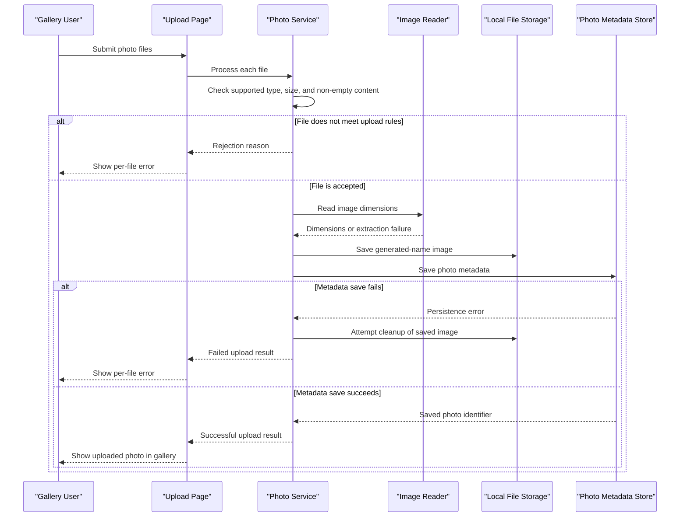

# Core Business Workflows

PhotoAlbum lets users upload, browse, view, and delete photos. Its central business process is adding an image to the gallery while keeping the stored file and its searchable metadata consistent.

## Domain Entities

| Entity | Service / Bounded Context | Description | Key Relationships |
|---|---|---|---|
| Photo | PhotoAlbum / Photo Gallery | A user-uploaded image managed in the gallery, with metadata used for display and retrieval | No relationships to other domain entities |

## Service-to-Domain Mapping

| Service | Domain Context | Owned Entities | External Dependencies |
|---|---|---|---|
| PhotoAlbum | Photo Gallery | Photo | SQL Server for metadata; local filesystem for image content |

There are no cross-service domain boundaries or data exchange flows in the solution.

## Primary Workflows

### Workflow 1: Upload Photos

1. A user selects or drops one or more files into the gallery.
2. The upload handler rejects an empty submission and processes each supplied file independently.
3. `PhotoService` checks the configured MIME type allowlist, maximum file size, and non-empty content. A rejected file returns a user-facing error without being saved.
4. The service generates a unique stored filename and attempts to read image dimensions. If dimension extraction fails, the upload can continue without dimensions.
5. The image file is written to local storage and its metadata is persisted.
6. If metadata persistence fails after the file was saved, the service attempts to delete the file as a compensating action.
7. The handler returns successful photo summaries and per-file failures to the browser.

The configured maximum number of files per upload is not enforced by the inspected upload handler or service.

### Workflow 2: Browse, View, and Delete

The gallery loads photos in newest-first order. A user can open a photo's detail page, request its image file, or submit a delete operation. Deletion removes the file when possible and then removes the metadata; file-deletion errors are logged, and metadata deletion continues.

## Cross-Service Data Flows

No cross-service aggregation or composition occurs. The gallery service reads its own photo metadata and corresponding local file content. If upload metadata persistence fails, it attempts to remove the already-written file; there is no remote-service fallback.

## Business Workflow Sequence

## Business Rules & Decision Logic

- Only configured image MIME types are accepted; the default allowlist is JPEG, PNG, GIF, and WebP.
- A file must be non-empty and must not exceed the configured maximum size (10 MiB by default).
- The upload handler accepts multiple files, but no maximum file count is enforced in the inspected server code.
- Image dimension extraction is best-effort; failure does not block saving the image.
- Stored filenames are generated uniquely, while the original filename remains available for display.
- If database persistence fails after writing a file, file deletion is attempted to avoid orphaned content.
- When a photo is deleted, failure to remove its file does not prevent deleting its metadata.
- Upload and deletion outcomes are logged. No business-level role or resource-ownership checks were identified.
