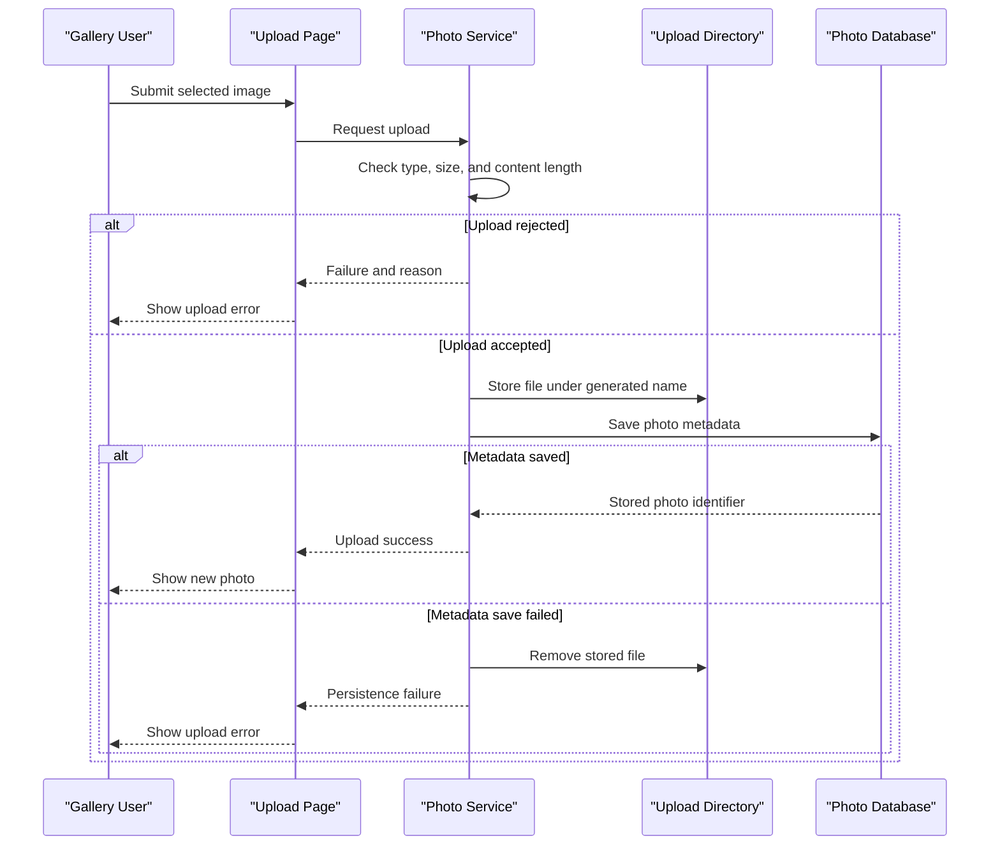

# Core Business Workflows

PhotoAlbum lets users upload, browse, inspect, serve, and delete photo files. A photo's metadata is stored alongside its locally persisted image file.

## Domain Entities

| Entity | Service / Bounded Context | Description | Key Relationships |
|---|---|---|---|
| Photo | PhotoAlbum / Photo Management | An uploaded image and its display and storage metadata | Stored as one metadata record with one local image file |

## Service-to-Domain Mapping

| Service | Domain Context | Owned Entities | External Dependencies |
|---|---|---|---|
| PhotoAlbum | Photo Management | Photo | SQL Server LocalDB and local filesystem |

## Primary Workflows

### Workflow 1: Upload Photos

1. The gallery accepts one or more files and sends them to the upload handler.
2. `PhotoService` checks the declared MIME type, configured file size, and non-empty content.
3. It creates a GUID-based stored name, attempts to read image dimensions, and writes the file to disk.
4. EF Core persists the `Photo` metadata.
5. On successful persistence, the handler returns upload summaries. If metadata persistence fails, the saved file is deleted as rollback; file-write and validation failures are returned as failed uploads.

Image decoding failure is logged but does not prevent the file from being saved without dimensions.

### Workflow 2: Browse and View a Photo

The gallery page loads metadata ordered newest first. Selecting a photo resolves its metadata and serves its file through the photo-file page; missing IDs or files return 404. The detail view also calculates adjacent photo navigation from the ordered gallery list.

### Workflow 3: Delete a Photo

The detail form submits a delete request. The service finds the photo, attempts to remove its image file, then deletes the metadata record. File deletion failure is logged, but database deletion continues. The page redirects to the gallery after success.

## Cross-Service Data Flows

No cross-service composition or data flow exists. The page handlers coordinate in-process service operations that use one database and one local filesystem.

## Business Workflow Sequence

## Business Rules & Decision Logic

- Only configured image MIME types are accepted by the upload service, and uploads are limited by configured size and non-empty content checks.
- The configured `MaxFilesPerUpload` value is present in settings; no corresponding enforcement was identified in the service.
- Stored names use a generated GUID; original names are retained as metadata.
- Image dimensions are optional metadata; an image decode failure does not fail the upload.
- File persistence and metadata persistence are coordinated with compensating file deletion when the database save fails.
- Deletion removes the file before saving metadata removal; if file deletion fails, metadata deletion still proceeds.
- Antiforgery tokens are included on upload and delete forms. No application authentication or user-specific ownership rule was identified.
