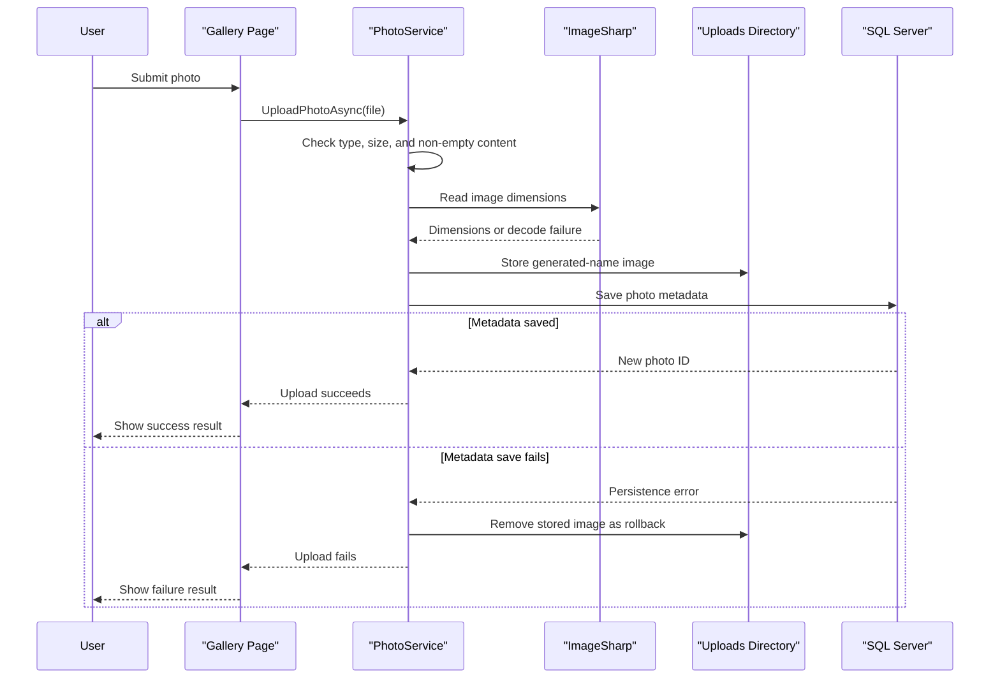

# Core Business Workflows

PhotoAlbum lets users maintain a personal gallery by uploading, browsing, viewing, and deleting photos. The main business data is a photo record linked to image content stored by the application.

## Domain Entities

| Entity | Service / Bounded Context | Description | Key Relationships |
|---|---|---|---|
| Photo | PhotoAlbum / Photo Gallery | Represents an uploaded image and the metadata needed to display and retrieve it | References an image file stored by the application; no other domain entities |

## Service-to-Domain Mapping

| Service | Domain Context | Owned Entities | External Dependencies |
|---|---|---|---|
| PhotoAlbum | Photo Gallery | Photo metadata and associated image files | SQL Server and local filesystem |

The single service is the source of truth for all photo records and image references. No cross-service domain exchange or aggregation is configured.

## Primary Workflows

### Workflow 1: Upload a photo

1. A user submits one or more files from the gallery.
2. `IndexModel` rejects an empty submission and delegates each file to `PhotoService`.
3. `PhotoService` checks the supplied MIME type, configured maximum file size, and non-empty length.
4. ImageSharp attempts to read image dimensions; dimension extraction failure is logged and does not prevent the upload from continuing.
5. The service writes the file under a generated GUID-based name and saves a `Photo` metadata record.
6. On database-save failure, the service attempts to delete the newly written image file. The page returns per-file success/failure details as JSON.

### Workflow 2: Browse and view photos

1. The gallery page loads photos ordered newest-first.
2. A user selects a photo; the detail page retrieves its metadata and displays size, dimensions, and upload time.
3. The browser requests the photo-file route by photo ID; the application looks up the metadata and reads the associated file.
4. Missing metadata or file content results in a not-found response.

### Workflow 3: Delete a photo

1. A user submits the delete action from the detail page.
2. The service loads the photo record by ID and deletes the associated file if present.
3. It removes the metadata record and saves database changes.
4. The page redirects to the gallery; failures are logged and redirect back to the detail page with an error message.

## Cross-Service Data Flows

There are no cross-service flows. The application combines photo metadata from SQL Server with image bytes from the local uploads directory. If the database save fails after upload, the file is removed as a compensating action; if file deletion fails during a delete operation, database deletion continues.

## Business Workflow Sequence

## Business Rules & Decision Logic

- Accepted MIME types are JPEG, PNG, GIF, and WebP; uploads must be non-empty and within the configured size limit.
- Uploads use generated storage names while retaining the original filename as metadata.
- Image dimensions are optional metadata: image-decoding failure does not block persistence.
- File creation precedes database metadata persistence; a database error triggers a compensating file deletion attempt.
- Deletion attempts to remove the file before deleting its database record; file deletion errors are logged, but database deletion proceeds.
- Photo metadata changes are persisted through EF Core. No explicit authorization-by-user, audit trail, or business state machine was identified.
