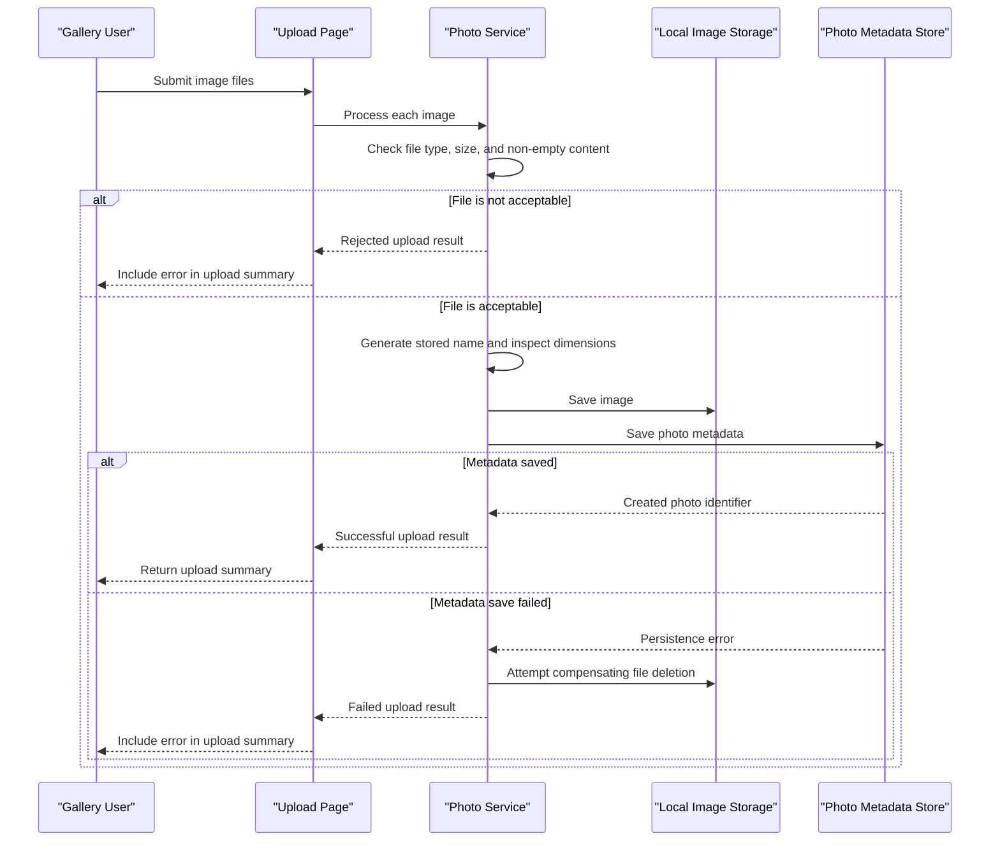

# Core Business Workflows

PhotoAlbum lets users upload and browse a personal photo collection, inspect individual images, and remove photos. Its main business lifecycle is the coordination of image files and their corresponding metadata.

## Domain Entities

| Entity | Service / Bounded Context | Description | Key Relationships |
|---|---|---|---|
| Photo | PhotoAlbum / Photo Management | A user-uploaded image and the metadata needed to display and manage it | Stored image file and metadata are coordinated by the photo-management context |
| UploadResult | PhotoAlbum / Photo Management | Outcome returned for an individual upload attempt | References the created Photo by identifier on success |

## Service-to-Domain Mapping

| Service | Domain Context | Owned Entities | External Dependencies |
|---|---|---|---|
| PhotoAlbum | Photo Management | Photo, UploadResult | SQL Server for metadata; local filesystem for image bytes |

## Primary Workflows

### Workflow 1: Upload Photos

1. A user submits one or more files from the gallery.
2. The upload handler rejects an empty submission; otherwise, it processes files individually through the photo service.
3. The service checks the configured MIME-type allowlist and size limit, then rejects empty files.
4. The service creates a unique stored filename and attempts to extract image dimensions. Dimension extraction failure is non-fatal.
5. The image bytes are saved to local storage, and photo metadata is persisted.
6. If metadata persistence fails after the file was written, the service attempts to delete the file as compensation. The handler returns a JSON summary of successful and failed files.

### Workflow 2: Browse and View Photos

The gallery loads metadata in newest-first order. Selecting a photo loads its detail view and neighboring-photo identifiers. The photo-file route retrieves metadata, locates the stored image, and returns the file; missing metadata or a missing file results in not-found behavior.

### Workflow 3: Delete a Photo

A user requests deletion from the detail view. The service loads the photo metadata, tries to delete its local file, and then removes its metadata from the database. A file deletion failure is logged but does not prevent database deletion; a database failure is propagated and the page redirects back with an error message.

## Cross-Service Data Flows

There are no separate application services or cross-service aggregation flows. The PhotoAlbum service coordinates data between its metadata store and local file storage; the image file and its database record are associated through the stored filename.

## Business Workflow Sequence

## Business Rules & Decision Logic

- Only configured image MIME types are accepted, and an upload must not exceed the configured maximum size or be empty.
- Multiple submitted files are processed independently; the overall JSON result reports successful and failed files.
- Image dimensions are optional metadata: inability to read dimensions does not prevent saving an otherwise acceptable image.
- A generated unique stored filename is used for each saved image.
- If metadata persistence fails after writing an image, the service attempts a compensating file deletion. Conversely, during photo deletion, file removal is best-effort and database removal proceeds even if the file cannot be deleted.
- EF Core `SaveChangesAsync` is used for metadata changes; no explicit cross-resource transaction covers both the database and filesystem.
- Failures are logged; upload failures are represented in the result, while unexpected deletion persistence failures are rethrown to the page handler.
- No workflow-level authorization, audit trail, lifecycle state machine, or inter-service consistency mechanism was identified.
