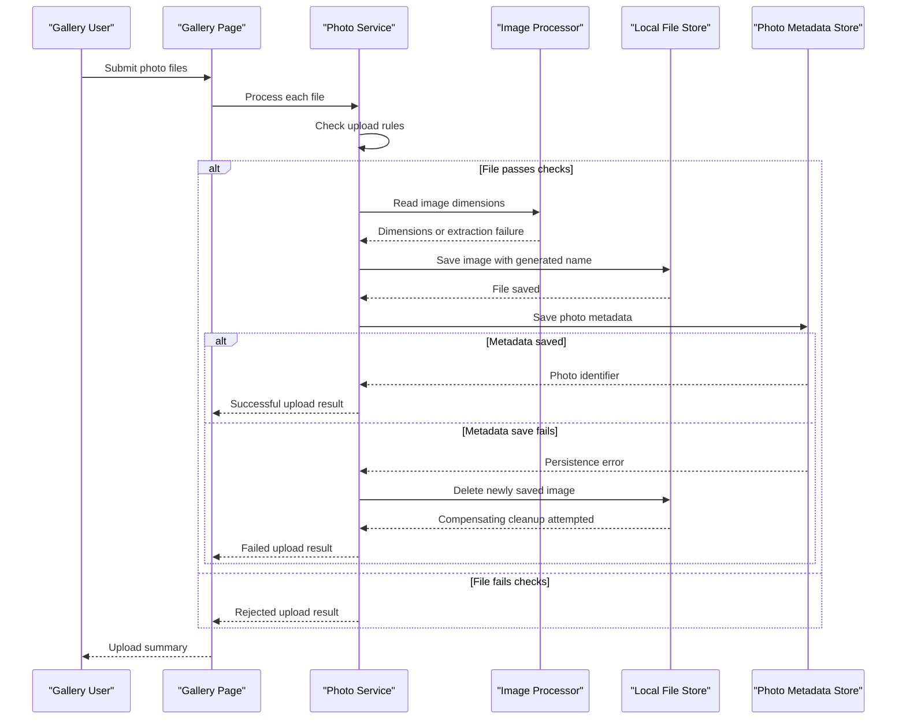

# Core Business Workflows

PhotoAlbum lets users maintain a personal photo gallery by uploading images, browsing stored photos, viewing details, and deleting items. Its business domain is centered on a single photo record paired with a stored image file.

## Domain Entities

| Entity | Service / Bounded Context | Description | Key Relationships |
|---|---|---|---|
| Photo | PhotoAlbum / Photo Gallery | A gallery item representing an uploaded image and its display metadata | One photo record refers to one locally stored image file; no other domain entity relationships are defined |

## Service-to-Domain Mapping

| Service | Domain Context | Owned Entities | External Dependencies |
|---|---|---|---|
| PhotoAlbum | Photo Gallery | Photo | SQL Server for metadata; local filesystem for image content |

## Primary Workflows

### Workflow 1: Upload Photo

1. A user submits one or more files from the gallery.
2. The application rejects files with unsupported MIME types, sizes over the configured limit, or empty content.
3. It creates a unique stored filename and attempts to read image dimensions; dimension extraction failure is non-fatal.
4. The image is written to local storage, then its metadata is added to the database.
5. If metadata persistence fails, the newly written image is deleted as a compensating action.
6. The caller receives a JSON result distinguishing successful and failed files.

### Workflow 2: Browse and View Photos

1. The gallery requests photos ordered newest-first.
2. The user selects a photo to see its details and navigation to adjacent gallery items.
3. The page retrieves the corresponding image by its photo identifier and serves the file content.
4. Missing metadata or image content produces a not-found result.

### Workflow 3: Delete Photo

1. A user submits the delete action for a photo.
2. The service looks up the photo record; an unknown identifier returns `false`.
3. The matching file is deleted when present. A file-deletion failure is logged, but database deletion continues.
4. The photo metadata is removed and the user is redirected to the gallery. An unexpected exception redirects back to the detail page with an error message.

## Cross-Service Data Flows

There are no independently deployed business services or cross-service aggregation flows. Photo metadata is owned by the gallery application and stored in its database; file content is read and written through local storage. The service compensates for a failed metadata save by deleting the file it just created.

## Business Workflow Sequence

## Business Rules & Decision Logic

- Accepted MIME types are JPEG, PNG, GIF, and WebP; the default maximum size is 10 MiB, and empty files are rejected.
- A generated GUID-based filename is used for stored images; original filename is retained as metadata.
- Image dimension extraction is best-effort and does not prevent upload when it fails.
- File content is saved before metadata. A metadata-save failure triggers a compensating file deletion attempt.
- During deletion, failure to remove the image file does not prevent metadata deletion; missing photo metadata returns `false`.
- The photo service logs upload, retrieval, and deletion failures. No explicit business transaction spans database and filesystem operations, and no role-based authorization rules are defined.
