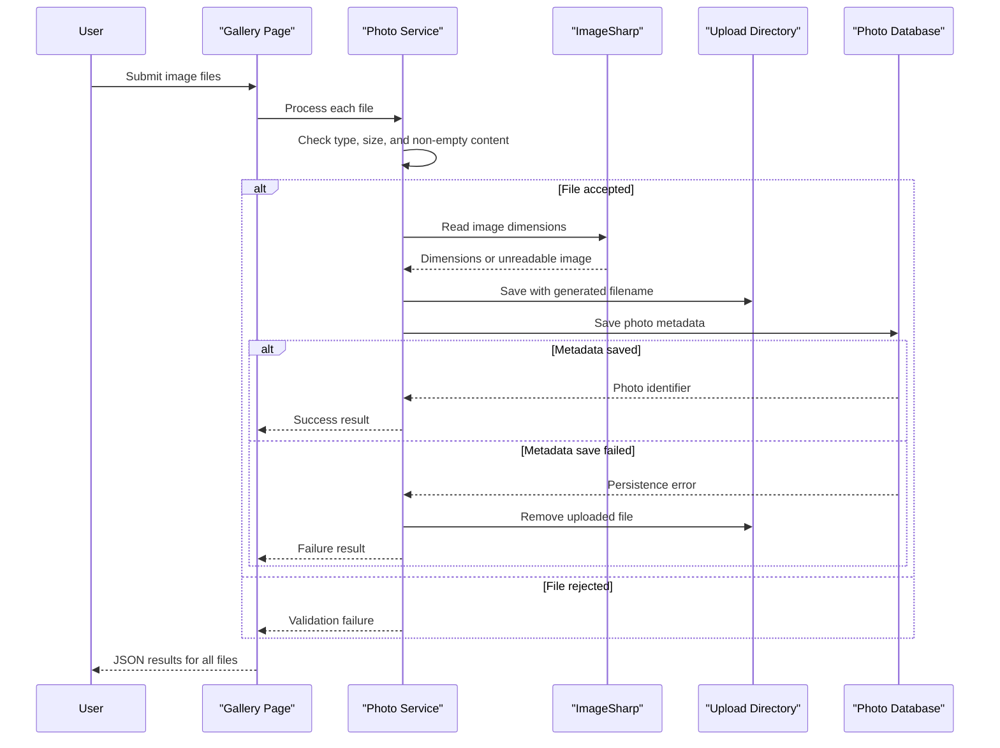

# Core Business Workflows

PhotoAlbum lets users browse a gallery, upload images, inspect image details, and remove photos. Each image is represented by metadata in the photo catalog and a corresponding local file.

## Domain Entities

| Entity | Service / Bounded Context | Description | Key Relationships |
|---|---|---|---|
| Photo | PhotoAlbum / Photo Catalog | An uploaded image and the metadata needed to display, locate, and manage it | The photo record points to its stored image file; no other domain entities |

## Service-to-Domain Mapping

| Service | Domain Context | Owned Entities | External Dependencies |
|---|---|---|---|
| PhotoAlbum | Photo Catalog | Photo | SQL Server for metadata; local filesystem for image bytes |

## Primary Workflows

### Workflow 1: Upload photos

The user submits one or more files from the gallery page. The page rejects an empty file collection, then processes each file through `PhotoService`. The service checks allowed MIME type, configured size, and non-empty content; reads dimensions with ImageSharp; writes the file using a generated name; and saves its metadata. If metadata persistence fails, it attempts to remove the newly written file. The page returns a JSON result separating successful and failed uploads.

### Workflow 2: View and navigate photos

The detail page loads the catalog, selects the requested photo, and calculates adjacent photo identifiers for navigation. A missing identifier or photo returns 404. The image route looks up metadata, resolves the stored filename under the upload directory, and returns the bytes with the recorded MIME type; missing files return 404.

### Workflow 3: Delete a photo

The detail page requests deletion by identifier. The service looks up the photo, attempts to delete its local file, then removes the metadata record. A file deletion error is logged but does not block metadata deletion. The page redirects to the gallery; exceptions redirect back to the detail page with an error message.

## Cross-Service Data Flows

There are no cross-service workflows or response aggregation. The single application coordinates metadata in SQL Server and file content on disk. Upload compensates for a metadata-save failure by deleting the new file; deletion is best-effort for the file and proceeds with metadata removal even when file deletion fails.

## Business Workflow Sequence

## Business Rules & Decision Logic

- Uploads must have an allowed MIME type, be no larger than the configured maximum, and contain non-empty data. The upload service processes files individually.
- Accepted uploads receive a generated GUID-based filename. Image dimensions are optional when the image cannot be decoded.
- The configured `MaxFilesPerUpload` value is not enforced by the current service.
- Upload persistence spans the filesystem and database without a distributed transaction; failed metadata saves trigger best-effort file cleanup.
- Deletion removes metadata even if local file deletion fails. Missing photo identifiers return a false result from the service.
- Operations use structured logging; there is no explicit audit trail, authentication, resource ownership rule, or role-based authorization.
