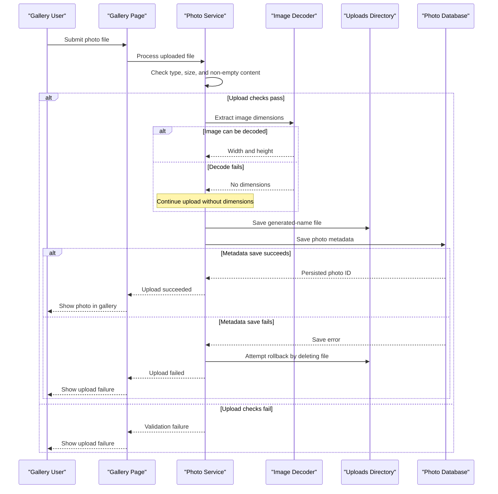

# Core Business Workflows

PhotoAlbum lets users upload photo files, browse a chronological gallery, open an individual photo, and delete it. The primary workflow stores photo bytes on disk and their descriptive metadata in a relational database.

## Domain Entities

| Entity | Service / Bounded Context | Description | Key Relationships |
|---|---|---|---|
| Photo | PhotoAlbum / Photo Gallery | A user-uploaded image with persisted file and display metadata | One Photo represents one uploaded file; no other domain entities are linked |

## Service-to-Domain Mapping

| Service | Domain Context | Owned Entities | External Dependencies |
|---|---|---|---|
| PhotoAlbum | Photo Gallery | Photo | SQL Server for metadata; local uploads directory for image bytes |

The application is a single service and has no cross-context data exchange or service aggregation.

## Primary Workflows

### Workflow 1: Upload photos

1. The user selects or drops one or more files on the gallery page; the browser posts a multipart request with an antiforgery token.
2. The page handler calls the photo service for each file.
3. The service checks the reported MIME type, configured file-size limit, and that the file is not empty.
4. It creates a GUID-based stored name, attempts to read image dimensions, then writes the bytes to the uploads directory.
5. It persists the photo metadata. If persistence fails after file creation, the service attempts to remove the saved file.
6. The page handler returns JSON describing successful uploads and failures, and the browser updates the gallery.

Dimension extraction is best-effort: an image decode error is logged and upload continues without dimensions. The server validates the configured MIME type and size, while the browser also performs client-side checks.

### Workflow 2: Browse and view a photo

The gallery handler retrieves all photos ordered newest first. Selecting an item loads the detail page, which retrieves the photo list, locates the requested ID, and displays the item with navigation to adjacent photos. The photo-file handler looks up metadata, reads the corresponding file, and returns it with the stored MIME type.

### Workflow 3: Delete a photo

The detail page posts the selected photo ID. The photo service looks up the record, attempts to remove its file, then removes the database record. A missing photo returns false; a filesystem deletion error is logged and database deletion continues.

## Cross-Service Data Flows

There are no cross-service calls or distributed data flows. PhotoService associates a database record with a local file through the generated stored filename and file path. The browser receives a photo-file response through the page handler; no fallback to a remote storage service is configured.

## Business Workflow Sequence

## Business Rules & Decision Logic

- Only configured MIME types are accepted, the configured size limit is enforced, and empty files are rejected.
- A generated unique name is used for stored image files; the original name is retained as metadata.
- Image dimensions are optional metadata; failure to extract them does not stop an upload.
- Database metadata is written after the file is saved; on database failure the file is removed as a compensating action.
- The gallery sorts by upload time, newest first. The model records upload time in UTC.
- Deletion removes metadata even if removing the associated file fails; the file error is logged.
- Upload and deletion are scoped to the application service and EF Core context; no explicit user authorization or ownership rule is implemented.
