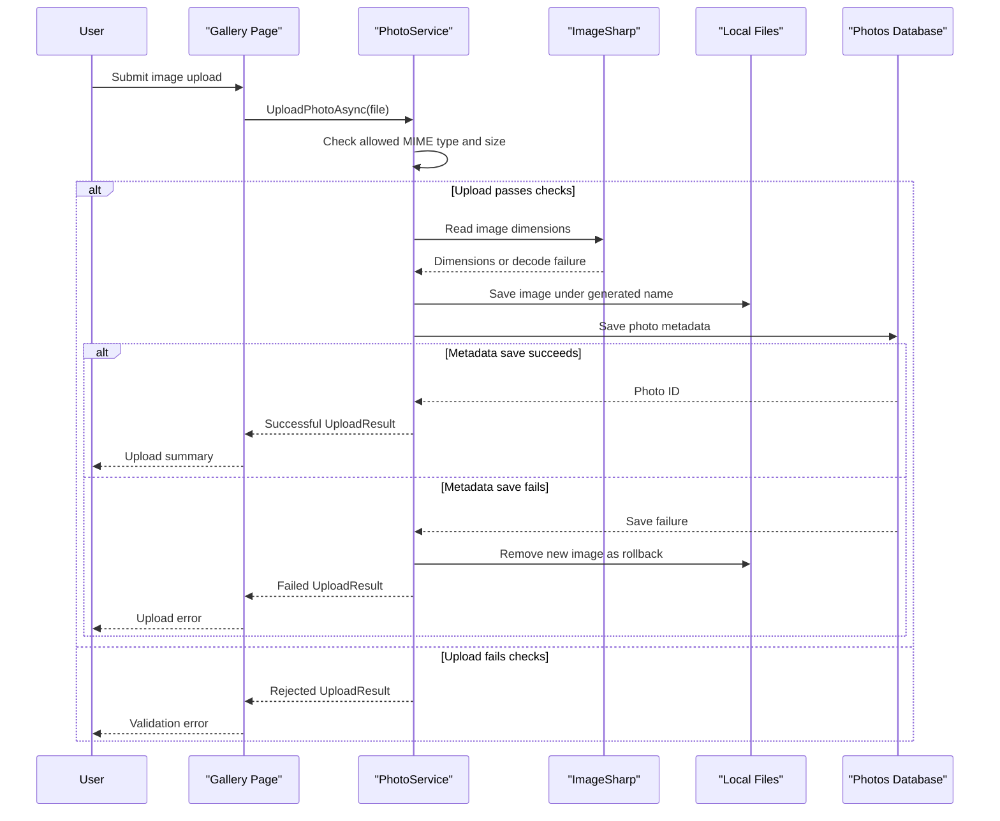

# Core Business Workflows

PhotoAlbum lets users upload, browse, inspect, and delete image files. Photo metadata is managed as a single application domain; image bytes are maintained in local storage.

## Domain Entities

| Entity | Service / Bounded Context | Description | Key Relationships |
|---|---|---|---|
| Photo | PhotoAlbum / Photo Gallery | Represents an uploaded image and the metadata needed to show, retrieve, and delete it | Its stored filename and relative path identify a corresponding file in local storage |

## Service-to-Domain Mapping

| Service | Domain Context | Owned Entities | External Dependencies |
|---|---|---|---|
| PhotoAlbum | Photo Gallery | Photo | SQL Server metadata store, local uploads directory, ImageSharp |

The application has no separate domain services or cross-context data exchange. `PhotoService` is the source of truth for photo metadata and coordinates local file operations.

## Primary Workflows

### Workflow 1: Upload a photo

1. A user submits one or more files from the gallery form.
2. The Index page handler calls `PhotoService.UploadPhotoAsync` for each file.
3. The service checks the submitted MIME type, file size, and empty-file condition.
4. It generates a unique stored name, attempts to read image dimensions with ImageSharp, writes the file, and adds metadata to the Photos table.
5. If metadata persistence fails, the service attempts to remove the newly written file and returns a failed upload result.

### Workflow 2: Browse and view photos

The gallery page retrieves photos ordered by upload time. A user can open a detail page, where the application displays metadata and retrieves the image through the photo-file page using the photo ID.

### Workflow 3: Delete a photo

The detail page sends a delete form submission to `PhotoService.DeletePhotoAsync`. The service looks up the record, attempts to delete the local file, removes the metadata, and saves changes. If file deletion fails, it logs the failure and continues deleting the database record.

## Cross-Service Data Flows

No cross-service calls, event streams, or gateway aggregation flows were identified. The web page handlers call the application service directly; the service writes metadata to SQL Server and image data to the local filesystem.

## Business Workflow Sequence

## Business Rules & Decision Logic

- Only configured MIME types are accepted, and files larger than the configured limit or with zero length are rejected.
- Successful uploads receive a generated storage name; the original filename is retained as metadata.
- Image dimension extraction is best effort: a decoding exception is logged and does not stop the file from being stored.
- The upload operation compensates for a metadata-save failure by attempting to delete the written file.
- Delete removes the file before saving metadata deletion; a file-delete error is logged, but metadata deletion continues.
- EF Core migrations run during application startup except when `IsTestEnvironment` is enabled; startup fails if migration application fails.
- Razor Page POST forms include antiforgery tokens. No user authentication or role-based authorization rules were found.
