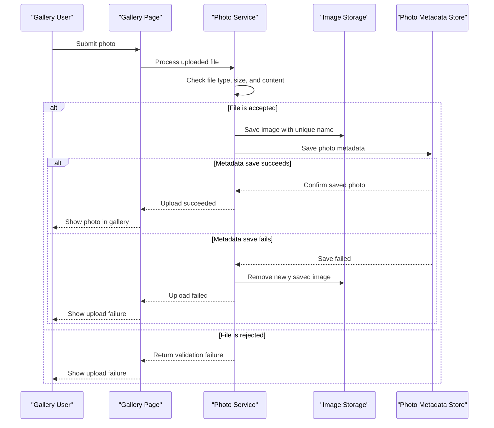

# Core Business Workflows

PhotoAlbum lets users maintain a personal gallery by uploading, browsing, viewing, and deleting photos. The primary business process is accepting a valid image, recording its metadata, and making it available in the gallery.

## Domain Entities

| Entity | Service / Bounded Context | Description | Key Relationships |
|---|---|---|---|
| Photo | PhotoAlbum / Photo Gallery | An uploaded image and the metadata needed to display and manage it | Each photo is independently managed; no other domain entities are modeled |

## Service-to-Domain Mapping

| Service | Domain Context | Owned Entities | External Dependencies |
|---|---|---|---|
| PhotoAlbum | Photo Gallery | Photo | SQL Server LocalDB for metadata; local filesystem for image content |

## Primary Workflows

### Workflow 1: Upload a Photo

1. A user submits one or more files from the gallery.
2. The application rejects missing file collections and the photo service checks each file's MIME type and size, then rejects empty files.
3. The service generates a unique stored filename and attempts to read image dimensions. If image dimension extraction fails, the upload continues without dimensions.
4. The service writes the image to local storage and persists its metadata.
5. If metadata persistence succeeds, the handler returns a successful upload summary. If persistence fails, the service deletes the newly written file as compensation and reports a failed upload.

### Workflow 2: View or Delete a Photo

The gallery loads stored photos in newest-first order. A user can select a photo to view its detail page or request the image file; a deletion request removes the image and its metadata. If the image deletion fails, the service logs the error and continues with metadata deletion.

## Cross-Service Data Flows

No cross-service composition or data exchange exists. The PhotoAlbum service coordinates its own metadata database and local file storage; the browser receives gallery and upload responses from the same application.

## Business Workflow Sequence

## Business Rules & Decision Logic

- Uploads are accepted only for configured image MIME types, up to the configured maximum file size, and must not be empty.
- The application does not require successful image dimension extraction to accept a file; dimensions are optional metadata.
- A new image file is removed if saving its metadata fails, preventing an orphan from that upload path.
- Photo listings are ordered by upload time, newest first. Deleting a missing photo returns a not-found outcome.
- Deletion removes the physical file before removing its database metadata; a filesystem deletion error is logged and does not prevent metadata deletion.
- No multi-service transaction, explicit authorization rule, audit trail, or state machine was identified.
