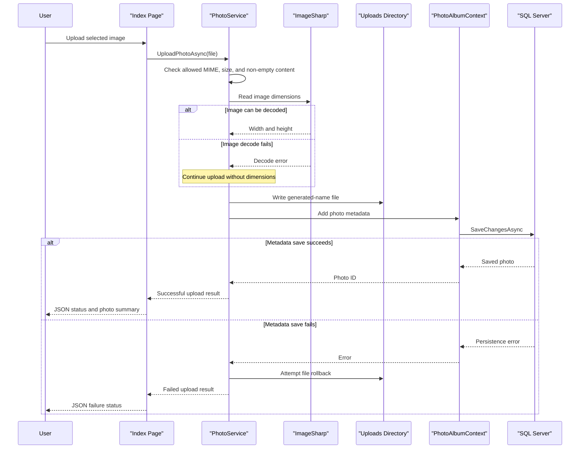

# Core Business Workflows

PhotoAlbum lets users upload, browse, inspect, and delete photo records. A photo consists of a stored image file and metadata used to display and manage it.

## Domain Entities

| Entity | Service / Bounded Context | Description | Key Relationships |
|---|---|---|---|
| Photo | PhotoAlbum / Photo Gallery | An uploaded image and its display and storage metadata | No other domain entities; one record references one stored file |

## Service-to-Domain Mapping

| Service | Domain Context | Owned Entities | External Dependencies |
|---|---|---|---|
| PhotoAlbum | Photo Gallery | Photo | SQL Server for metadata; local filesystem for image content |

There are no separate business services or cross-context data exchanges. `PhotoService` is the single application boundary for photo operations.

## Primary Workflows

### Workflow 1: Upload Photos

1. The user selects or drops one or more files in the gallery; the browser performs preliminary MIME-type and size checks.
2. The browser posts multipart files and an antiforgery token to `/Index?handler=Upload`.
3. `IndexModel` calls `PhotoService.UploadPhotoAsync` for each file.
4. `PhotoService` checks the claimed content type, maximum byte size, and non-empty length, then generates a GUID-based stored filename.
5. ImageSharp attempts to read dimensions. A decode error is logged, but the upload continues without dimensions.
6. The service writes the uploaded bytes to the uploads directory and persists the `Photo` metadata.
7. If metadata persistence fails, the service attempts to remove the newly written file; the handler returns a JSON result for successes and failures.

### Workflow 2: Browse and Delete a Photo

The gallery loads photos in descending upload-time order. A user opens a photo detail page to view the image and metadata, then submits the antiforgery-protected delete form. `DetailModel` calls `PhotoService.DeletePhotoAsync`; the service attempts to delete the local file and then removes the metadata record. A missing photo returns false; page-level exceptions are logged and surfaced as a redirect with an error message.

## Cross-Service Data Flows

No service-to-service composition exists. Photo metadata is read and written in SQL Server while photo bytes are stored in the local uploads directory. The production infrastructure template provisions Blob Storage and passes its endpoint and container name to the container app, but application code does not currently use these settings.

## Business Workflow Sequence

## Business Rules & Decision Logic

- Uploads are restricted by configured MIME types, maximum file size, and non-empty content checks. The browser also performs client-side checks, but the server is responsible for validation.
- Stored filenames use a generated GUID plus the supplied filename extension; original names are retained as metadata.
- Image decoding is used to populate optional width/height values. Decode failure does not currently prevent file persistence.
- Photo metadata is saved after file storage. If metadata persistence fails, the service attempts compensating file deletion.
- Delete processing attempts file deletion before deleting the database record; file deletion errors are logged and database deletion continues.
- Upload and delete operations use EF Core save calls; no multi-service transaction, saga, audit trail, or role-based authorization workflow was identified.
