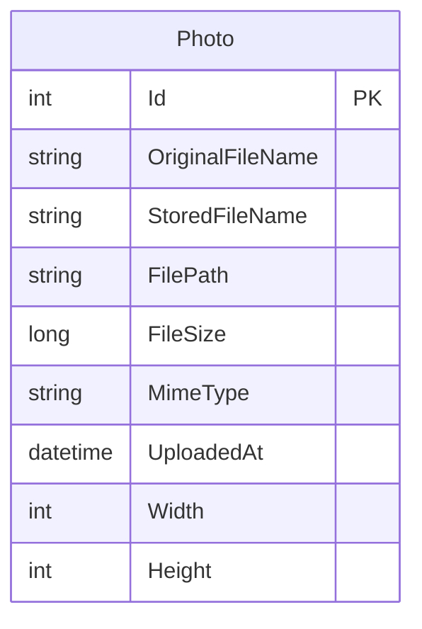

# Data Architecture & Persistence Layer

PhotoAlbum stores one metadata entity in SQL Server through EF Core and keeps image bytes in the local filesystem. The test project substitutes EF Core's in-memory provider for the application database.

## Database Configuration

| Service/Module | DB Type | Profile | Driver | Connection | Migration Tool |
|---|---|---|---|---|---|
| PhotoAlbum | SQL Server LocalDB by default | Default/development | EF Core SQL Server 9.0.9 | Configured by `ConnectionStrings:DefaultConnection` | EF Core migrations, applied at application startup except in test environment |
| PhotoAlbum.Tests | EF Core InMemory | Tests | EF Core InMemory 9.0.9 | Unique in-memory database per test fixture | None |

The repository also contains Azure deployment configuration that uses Azure SQL with Microsoft Entra authentication. No separate database profile files were found.

## Data Ownership per Service

| Service | Tables Owned | ORM Framework | Caching | Notes |
|---|---|---|---|---|
| PhotoAlbum | Photos | EF Core 9.0.9 | None | Owns photo metadata; image bytes are stored separately on disk |
| PhotoAlbum.Tests | Test-only in-memory Photos data | EF Core InMemory 9.0.9 | None | Uses an isolated database per test fixture |

## Entity Model

`Photo` is defined in `PhotoAlbum/Models/Photo.cs`. It represents an uploaded image and its metadata; `Id` is the primary key. The model has no foreign-key relationships. EF Core configures an index on upload time and required/max-length constraints for the stored metadata. File bytes are outside the database and are referenced by the stored filename/path.

## Key Repository Methods

| Service | Repository | Notable Methods | Purpose |
|---|---|---|---|
| PhotoAlbum | `PhotoService` (`PhotoAlbum/Services/PhotoService.cs`) | `GetAllPhotosAsync()` | Reads photo records ordered by upload time |
| PhotoAlbum | `PhotoService` (`PhotoAlbum/Services/PhotoService.cs`) | `GetPhotoByIdAsync(int)` | Finds one photo by primary key |
| PhotoAlbum | `PhotoService` (`PhotoAlbum/Services/PhotoService.cs`) | `UploadPhotoAsync(IFormFile)` | Adds metadata after storing the image |
| PhotoAlbum | `PhotoService` (`PhotoAlbum/Services/PhotoService.cs`) | `DeletePhotoAsync(int)` | Removes the image file and metadata |

There is no separate repository interface; the service uses `PhotoAlbumContext` directly. `PhotoAlbumContext` is defined in `PhotoAlbum/Data/PhotoAlbumContext.cs`.

## Caching Strategy

No application data cache or ORM query cache is configured. Static-file responses receive a one-hour cache header; photo-file responses set a one-year cache header and an ETag.

## Data Ownership Boundaries

The application is a single service with one SQL database. `PhotoService` is the single application component that performs metadata operations; page handlers call it rather than accessing the context directly. The database stores metadata while local storage owns the image bytes; the `StoredFileName` and `FilePath` values link the records to files. No cross-service access, CQRS, or event-driven data exchange was identified.

### Data Classification & Sensitivity

| Entity | Sensitive Fields | Classification (PII/PHI/PCI/None) | Controls in Place |
|---|---|---|---|
| Photo | `OriginalFileName`; uploaded image contents may depict identifiable people | Potential PII | No field-level masking or explicit application-level encryption-at-rest configuration found |
| Photo | None related to health or payment data in the entity model | None detected | Not applicable |

