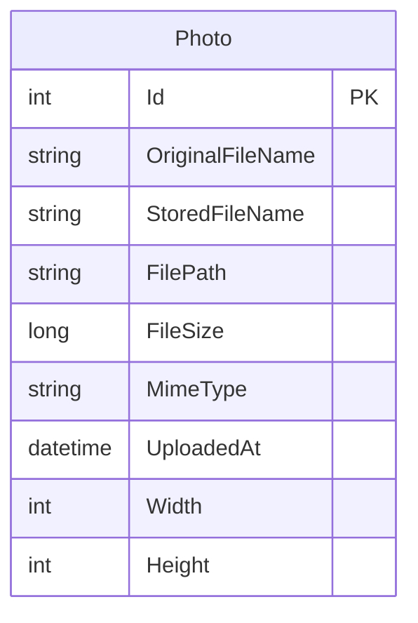

# Data Architecture & Persistence Layer

PhotoAlbum persists one photo metadata entity in SQL Server through EF Core and stores image contents as files. Tests substitute an EF Core in-memory database and temporary directory.

## Database Configuration

| Service/Module | DB Type | Profile | Driver | Connection | Migration Tool |
|---|---|---|---|---|---|
| PhotoAlbum | SQL Server | Local development | Microsoft.EntityFrameworkCore.SqlServer 9.0.9 | LocalDB connection configured in `appsettings.json` and `Web.config`; deploy-time connection can be overridden | EF Core migrations, applied on startup outside test mode |
| PhotoAlbum.Tests | EF Core InMemory | Tests | Microsoft.EntityFrameworkCore.InMemory 9.0.9 | Unique in-memory database per test fixture | None |

## Data Ownership per Service

| Service | Tables Owned | ORM Framework | Caching | Notes |
|---|---|---|---|---|
| PhotoAlbum | Photos | EF Core 9 | None | Stores metadata; image content is held in the uploads directory |
| PhotoAlbum.Tests | Test-local Photos | EF Core InMemory | None | Test fixture uses an isolated database and temporary files |

## Entity Model

`Photo` is defined in `PhotoAlbum/Models/Photo.cs` and is the only persisted entity. It has no entity relationships or foreign keys. The EF Core model defines an index on upload time and required/max-length constraints for the filename, path, and MIME metadata.

## Key Repository Methods

| Service | Repository | Notable Methods | Purpose |
|---|---|---|---|
| PhotoAlbum | `PhotoAlbumContext` (`PhotoAlbum/Data/PhotoAlbumContext.cs`) | `Photos` DbSet; no custom repository methods | EF Core entity access; `PhotoService` orders photos by upload time and performs key-based lookup |

## Caching Strategy

No application-level cache, distributed cache, or ORM second-level cache was identified. Photo requests read metadata and image bytes from the database and file system respectively.

## Data Ownership Boundaries

The single application service owns all photo metadata in one SQL Server database. Image bytes live in the local uploads directory and are referenced by metadata; there are no cross-service database accesses, CQRS read stores, or message-driven synchronization flows. Upload logic compensates for a metadata-save failure by deleting the just-written file.

### Data Classification & Sensitivity

| Entity | Sensitive Fields | Classification (PII/PHI/PCI/None) | Controls in Place |
|---|---|---|---|
| Photo | User-uploaded image content and original filename may contain identifying information | Potential PII | No field-level encryption or masking identified; storage uses the configured database and local filesystem |

