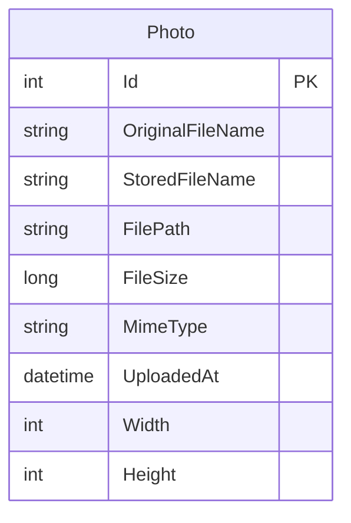

# Data Architecture & Persistence Layer

The data layer contains one photo metadata entity stored in SQL Server and uses Entity Framework Core for queries and migrations. The image bytes are stored separately in the local uploads directory.

## Database Configuration

| Service/Module | DB Type | Profile | Driver | Connection | Migration Tool |
|---|---|---|---|---|---|
| PhotoAlbum | SQL Server LocalDB | Default runtime configuration | EF Core SQL Server 9.0.9 | `DefaultConnection` in `appsettings.json` | EF Core migrations, applied at startup outside test mode |
| PhotoAlbum.Tests | EF Core InMemory | Test environment | EF Core InMemory 9.0.9 | In-memory database configured by tests | No schema migration in test mode |

The repository includes an initial EF Core migration and model snapshot. No seed-data migration or programmatic seed routine was identified.

## Data Ownership per Service

| Service | Tables Owned | ORM Framework | Caching | Notes |
|---|---|---|---|---|
| PhotoAlbum | Photos | Entity Framework Core 9.0.9 | None detected | PhotoService uses PhotoAlbumContext directly |

## Entity Model

`Photo` is defined in `PhotoAlbum/Models/Photo.cs` and maps to the `Photos` table through `PhotoAlbumContext`. It has a descending index on `UploadedAt`; the model contains no relationships to other entities. EF Core operations are asynchronous, with no explicit transaction scope beyond EF Core's save operations.

## Key Repository Methods

| Service | Repository | Notable Methods | Purpose |
|---|---|---|---|
| PhotoAlbum | `PhotoAlbumContext` (`PhotoAlbum/Data/PhotoAlbumContext.cs`) | `Photos` DbSet; no custom repository methods | Provides EF Core access to photo metadata |
| PhotoAlbum | `PhotoService` (`PhotoAlbum/Services/PhotoService.cs`) | `GetAllPhotosAsync`, `GetPhotoByIdAsync`, `UploadPhotoAsync`, `DeletePhotoAsync` | Uses EF Core queries and writes; there are no separate repository interfaces or custom SQL queries |

## Caching Strategy

No application-level cache, cache provider, cache-aside pattern, or query-result caching was detected. HTTP responses for static files and served photo content set cache headers, which are response caching directives rather than a server-side data cache.

## Data Ownership Boundaries

The single application owns the `Photos` table and local image files. There are no service-to-service boundaries or cross-service database access patterns. Photo metadata and bytes are stored separately and associated through the generated stored filename and relative path; there is no CQRS or outbox pattern.

### Data Classification & Sensitivity

| Entity | Sensitive Fields | Classification (PII/PHI/PCI/None) | Controls in Place |
|---|---|---|---|
| Photo | `OriginalFileName`; uploaded image content may depict identifiable people | Potential PII | No field-level masking or application-configured encryption-at-rest was identified; database and filesystem protections depend on the deployment environment |

