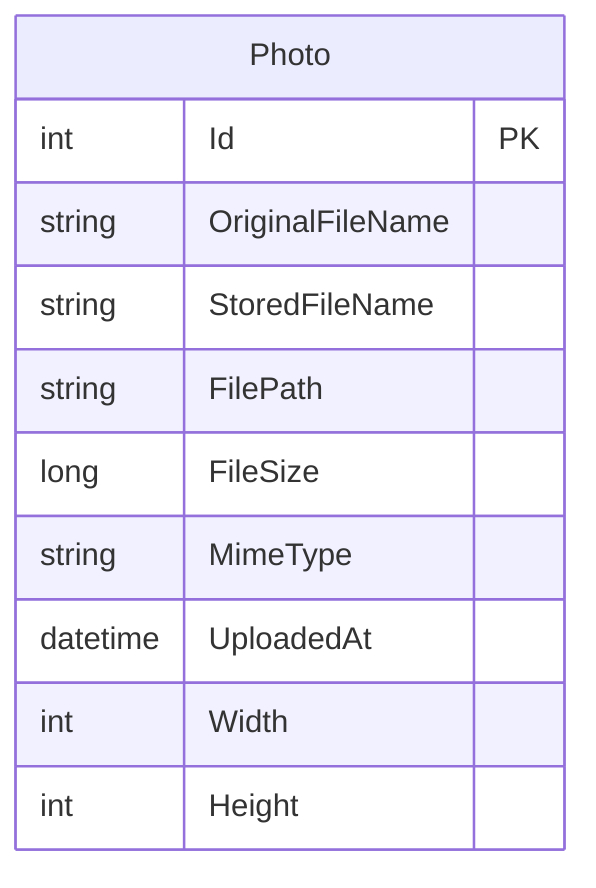

# Data Architecture & Persistence Layer

The application persists one photo metadata entity using Entity Framework Core and SQL Server LocalDB, with image bytes stored separately on the local filesystem. Tests use an EF Core in-memory database provider.

## Database Configuration

| Service/Module | DB Type | Profile | Driver | Connection | Migration Tool |
|---|---|---|---|---|---|
| PhotoAlbum | SQL Server LocalDB | Default application configuration | Microsoft.EntityFrameworkCore.SqlServer 9.0.9 | LocalDB connection configured in `appsettings.json` | EF Core migrations; startup applies migrations unless test mode is enabled |
| PhotoAlbum.Tests | In-memory database | Test configuration | Microsoft.EntityFrameworkCore.InMemory 9.0.9 | Test database configured in test code | None; transient test database |

The initial EF Core migration and model snapshot are present. No seed data was identified.

## Data Ownership per Service

| Service | Tables Owned | ORM Framework | Caching | Notes |
|---|---|---|---|---|
| PhotoAlbum | Photos | Entity Framework Core 9.0 | None identified | Owns photo metadata; image content is kept in local files |

## Entity Model

`Photo` is defined in `PhotoAlbum/Models/Photo.cs`. The entity has a primary key, required filename/path/size/type/timestamp properties, length constraints for string columns, and optional width and height values. `PhotoAlbumContext` defines a descending index on `UploadedAt`. No entity relationships or transaction scope configuration were identified.

## Key Repository Methods

| Service | Repository | Notable Methods | Purpose |
|---|---|---|---|
| PhotoAlbum | `PhotoAlbumContext` (`PhotoAlbum/Data/PhotoAlbumContext.cs`) | `Photos` DbSet; no custom repository methods | Exposes the photo entity set to `PhotoService`, which performs EF Core queries and writes directly |

No separate repository interface or custom query class was identified. `PhotoService` orders all photos by upload time and looks up individual records through EF Core.

## Caching Strategy

No application-level cache provider or cache-aside/read-through strategy was identified. Static assets and served photo responses set HTTP cache headers; these are client/proxy response headers, not a server-side data cache.

## Data Ownership Boundaries

There is one application-owned metadata store, with no cross-service database access or service-to-service data sharing. Photo records and image files are separate persistence resources: metadata is queried through EF Core and image bytes are accessed through the filesystem. The application uses ordinary read/write operations rather than CQRS.

### Data Classification & Sensitivity

| Entity | Sensitive Fields | Classification | Controls in Place |
|---|---|---|---|
| Photo | `OriginalFileName`, `FilePath`, and image content referenced by the record | Potential personal data depending on the photo and filename; no explicit PHI or PCI fields identified | No encryption-at-rest, field-level masking, or field-level access controls identified |
