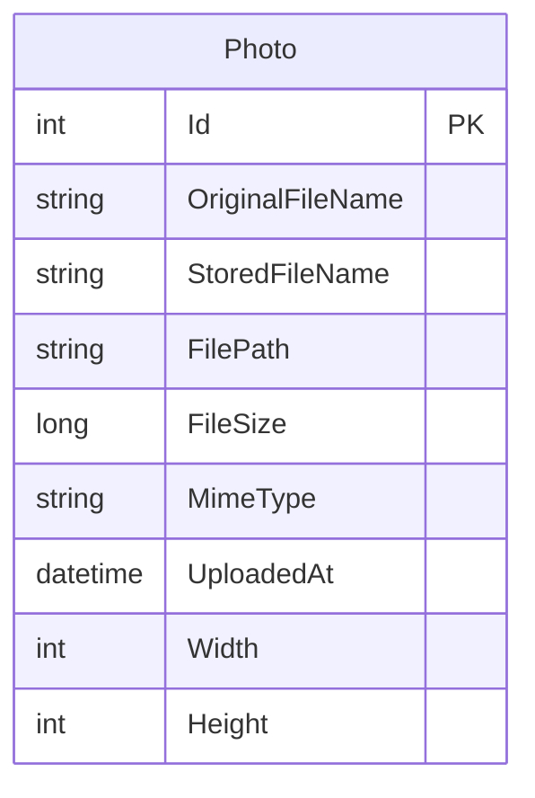

# Data Architecture & Persistence Layer

The application has one persisted entity managed by EF Core and SQL Server. Image bytes are stored separately on local disk, with the database holding image metadata and a relative path.

## Database Configuration

| Service/Module | DB Type | Profile | Driver | Connection | Migration Tool |
|---|---|---|---|---|---|
| PhotoAlbum | SQL Server LocalDB | Default / Development | EF Core SQL Server 9.0.9 | LocalDB instance `mssqllocaldb` | EF Core migrations |
| PhotoAlbum.Tests | EF Core InMemory | Test | EF Core InMemory 9.0.9 | In-process ephemeral provider | None |

Migrations are applied during application startup unless `IsTestEnvironment` is true. One initial migration creates the photo table and upload-date index.

## Data Ownership per Service

| Service | Tables Owned | ORM Framework | Caching | Notes |
|---|---|---|---|---|
| PhotoAlbum | Photos | EF Core 9 | None | Owns all photo metadata; image bytes are stored in local files |

## Entity Model

`Photo` is defined in `PhotoAlbum/Models/Photo.cs`. It has no entity relationships to other tables. The entity marks core metadata as required and constrains filename, path, and MIME type lengths.

## Key Repository Methods

| Service | Repository | Notable Methods | Purpose |
|---|---|---|---|
| PhotoAlbum | `PhotoAlbumContext.Photos` (`PhotoAlbum/Data/PhotoAlbumContext.cs`) | `OrderByDescending(UploadedAt).ToListAsync()` | Retrieves photos newest-first |
| PhotoAlbum | `PhotoAlbumContext.Photos` | `FindAsync(id)` | Retrieves one photo by its primary key |
| PhotoAlbum | `PhotoAlbumContext.Photos` | `AddAsync` / `Remove` and `SaveChangesAsync` | Persists or removes photo metadata |

No dedicated repository interface or custom SQL query is declared.

## Caching Strategy

No application data cache is configured. Static files have a one-hour response cache header and served photo files have a one-year cache header with an ETag; these are HTTP client/proxy caching directives, not a server-side data cache.

## Data Ownership Boundaries

The single application owns the complete SQL database and local upload directory; there are no service boundaries or cross-service data access patterns. Metadata changes use EF Core while image content is written to or removed from the filesystem as a separate operation. There is no CQRS or shared database between services.

### Data Classification & Sensitivity

| Entity | Sensitive Fields | Classification (PII/PHI/PCI/None) | Controls in Place |
|---|---|---|---|
| Photo | `OriginalFileName` may contain user-supplied identifying information; image content may depict identifiable people | Potential PII | No field-level encryption or masking identified; upload type and size checks only |

