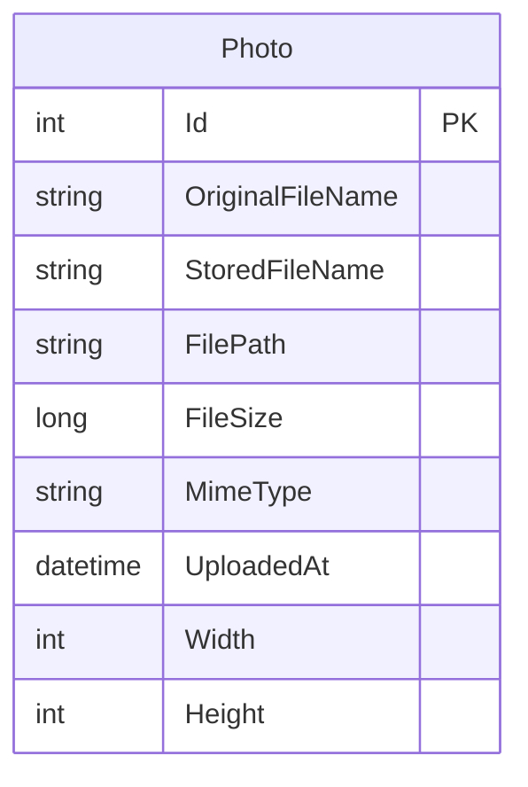

# Data Architecture & Persistence Layer

PhotoAlbum persists one photo metadata entity through EF Core and SQL Server, while image content is stored on the local filesystem. Tests substitute EF Core InMemory for SQL Server.

## Database Configuration

| Service/Module | DB Type | Profile | Driver | Connection | Migration Tool |
|---|---|---|---|---|---|
| PhotoAlbum | SQL Server LocalDB | Default/development | EF Core SQL Server 9.0.9 | `DefaultConnection` from appsettings; LocalDB with trusted connection | EF Core migrations, applied at startup outside test mode |
| PhotoAlbum | Azure SQL | Production deployment template | EF Core SQL Server 9.0.9 | `ConnectionStrings__DefaultConnection` with Azure AD Default authentication | EF Core migrations, applied during startup |
| PhotoAlbum.Tests | EF Core InMemory | Tests | EF Core InMemory 9.0.9 | Per-test in-memory database | None |

The deployment template also creates an Azure Storage account, but application code currently writes photo content to the local uploads directory.

## Data Ownership per Service

| Service | Tables Owned | ORM Framework | Caching | Notes |
|---|---|---|---|---|
| PhotoAlbum | `Photos` | EF Core 9 | None identified | Owns photo metadata; photo files are stored locally |

## Entity Model

`PhotoAlbum/Models/Photo.cs` defines the single entity. `PhotoAlbum/Data/PhotoAlbumContext.cs` configures the primary key, metadata lengths, and a descending index on upload time. There are no entity relationships. EF Core `SaveChangesAsync` persists upload and deletion changes; the service coordinates file cleanup when metadata persistence fails.

## Key Repository Methods

| Service | Repository | Notable Methods | Purpose |
|---|---|---|---|
| PhotoAlbum | `PhotoAlbumContext.Photos` (`PhotoAlbum/Data/PhotoAlbumContext.cs`) | `FindAsync(id)`, ordered `ToListAsync()`, `AddAsync(photo)`, `Remove(photo)`, `SaveChangesAsync()` | Retrieve, list, add, and delete photo metadata; no custom repository interface or raw SQL query is defined |

## Caching Strategy

No application-level cache, cache provider, cache TTL, or cache-aside pattern was identified. The photo file endpoint sets browser cache headers for returned files, which is HTTP response caching rather than server-side data caching.

## Data Ownership Boundaries

PhotoAlbum is a single-service application with one `Photos` table and no cross-service database access, shared schema, or CQRS boundary. `PhotoService` is the data-operation boundary; page models call it rather than querying EF Core directly. Photo content is stored separately from metadata on the local filesystem.

### Data Classification & Sensitivity

| Entity | Sensitive Fields | Classification (PII/PHI/PCI/None) | Controls in Place |
|---|---|---|---|
| Photo | User-provided image content and original filename may contain identifying information | Potential PII | No application-level encryption, masking, or field-level access controls identified for local uploaded files or metadata |
