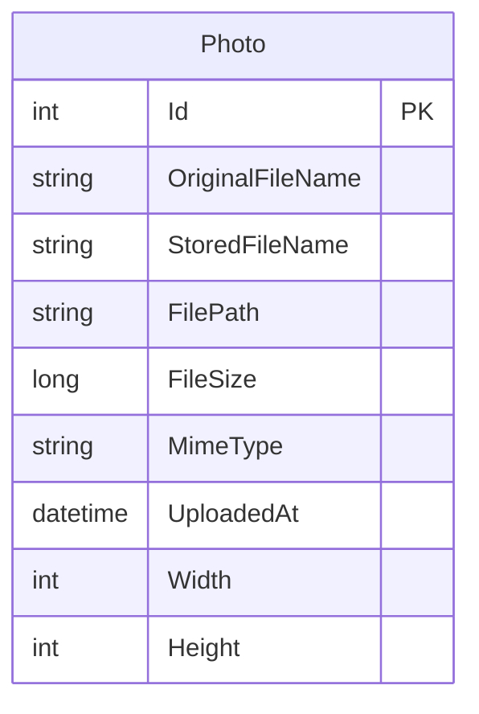

# Data Architecture & Persistence Layer

PhotoAlbum stores photo metadata in a single relational entity using EF Core and keeps image bytes on the local filesystem. The test project uses an in-memory EF Core provider.

## Database Configuration

| Service/Module | DB Type | Profile | Driver | Connection | Migration Tool |
|---|---|---|---|---|---|
| PhotoAlbum | SQL Server LocalDB | Default/development | EF Core SQL Server 9.0.9 | LocalDB `PhotoAlbumDb` | EF Core Migrations, applied at application startup except in tests |
| PhotoAlbum.Tests | EF Core InMemory | Tests | EF Core InMemory 9.0.9 | In-memory test database | None |

## Data Ownership per Service

| Service | Tables Owned | ORM Framework | Caching | Notes |
|---|---|---|---|---|
| PhotoAlbum | Photos | EF Core 9.0.9 | None | Metadata owner; image bytes are on local disk |

## Entity Model

`Photo` is defined in `PhotoAlbum/Models/Photo.cs`. `PhotoAlbumContext` configures the primary key, required metadata, and a descending index on upload time. No entity relationships or foreign keys are defined.

## Key Repository Methods

| Service | Repository | Notable Methods | Purpose |
|---|---|---|---|
| PhotoAlbum | `PhotoAlbumContext` (`PhotoAlbum/Data/PhotoAlbumContext.cs`) | `Photos` DbSet | EF Core access to photo metadata |
| PhotoAlbum | `PhotoService` (`PhotoAlbum/Services/PhotoService.cs`) | `GetAllPhotosAsync`, `GetPhotoByIdAsync`, `UploadPhotoAsync`, `DeletePhotoAsync` | Application-level query, upload, and deletion operations |

No separate repository interface or custom SQL query was found. EF Core LINQ and key lookup are used for data access.

## Caching Strategy

No application cache, distributed cache, or ORM second-level cache was identified. Photo files are served with HTTP cache headers, which is client/browser caching rather than a server-side data cache.

## Data Ownership Boundaries

The application is a single deployable service with one SQL Server database and a local upload directory. It reads and writes its own metadata and image files; no cross-service access, CQRS split, or cross-database data flow was identified.

### Data Classification & Sensitivity

| Entity | Sensitive Fields | Classification (PII/PHI/PCI/None) | Controls in Place |
|---|---|---|---|
| Photo | Uploaded image content and original file name may contain personal data | Potential PII | No field-level encryption or masking identified; access is not tied to an authenticated user |

