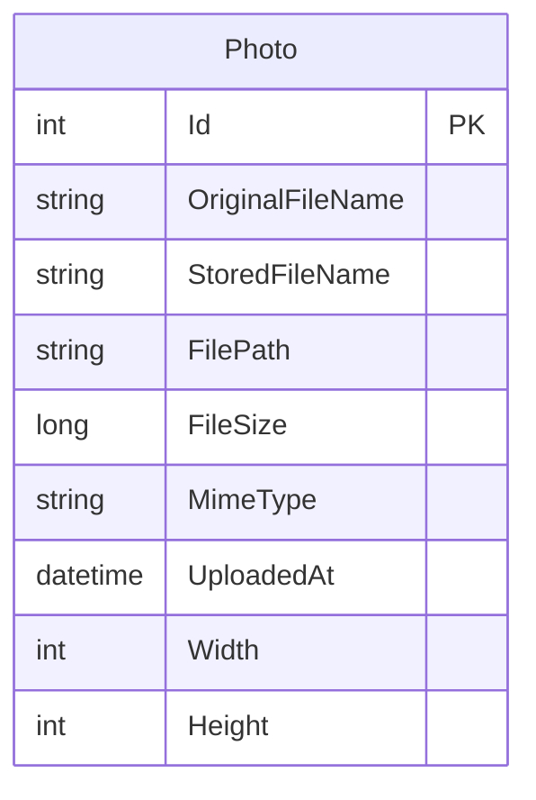

# Data Architecture & Persistence Layer

The application persists one photo metadata entity through Entity Framework Core, with SQL Server LocalDB as the configured database. Uploaded image files are stored separately on the local filesystem.

## Database Configuration

| Service/Module | DB Type | Profile | Driver | Connection | Migration Tool |
|---|---|---|---|---|---|
| PhotoAlbum | SQL Server LocalDB | Default application configuration | EF Core SQL Server provider 9.0.9 | Configured through the default connection string in appsettings | EF Core migrations applied at startup except in test mode |
| PhotoAlbum.Tests | EF Core InMemory | Test configuration | EF Core InMemory provider 9.0.9 | In-memory test database | None |

## Data Ownership per Service

| Service | Tables Owned | ORM Framework | Caching | Notes |
|---|---|---|---|---|
| PhotoAlbum | Photos | Entity Framework Core 9.0.9 | No data cache identified | Owns photo metadata; image content is stored in the local uploads directory |

## Entity Model

`Photo` is defined in `PhotoAlbum/Models/Photo.cs`. Its scalar metadata has required and length constraints where configured, while image dimensions are nullable. `PhotoAlbumContext` in `PhotoAlbum/Data/PhotoAlbumContext.cs` maps the entity and configures a descending index on upload time. No entity relationships or explicit transaction scopes were identified.

## Key Repository Methods

| Service | Repository | Notable Methods | Purpose |
|---|---|---|---|
| PhotoAlbum | `PhotoAlbumContext` (`PhotoAlbum/Data/PhotoAlbumContext.cs`) | `Photos` DbSet; no custom repository methods | Provides EF Core access to the photo entity; queries and ordering are composed in `PhotoService` |

## Caching Strategy

No database or application data cache provider was identified. The application adds HTTP cache headers to static assets and photo responses; no cache-aside or query-result caching strategy is configured.

## Data Ownership Boundaries

PhotoAlbum is the only independently deployable application service and owns its photo metadata store. The SQL Server database and local uploads directory are separate persistence resources used by the same service; no cross-service database access, CQRS, or distributed data boundary was identified. The test project uses an in-memory EF Core provider rather than the configured LocalDB database.

### Data Classification & Sensitivity

| Entity | Sensitive Fields | Classification (PII/PHI/PCI/None) | Controls in Place |
|---|---|---|---|
| Photo | Original filename and uploaded image content may contain personal information | Potential PII in unstructured user-provided content; no PHI or PCI fields identified | No encryption-at-rest, masking, or field-level access controls are documented |

