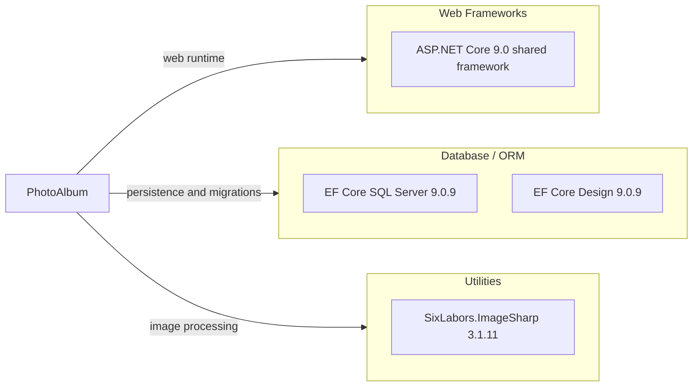

# Dependency Map

PhotoAlbum consists of one web project and one test project. The application declares three direct runtime/package dependencies and the test project declares six test-oriented dependencies.

## Dependencies

### Dependency Summary

| Category | Count | Key Libraries | Notes |
|---|---:|---|---|
| Web Frameworks | 1 | ASP.NET Core 9.0 | Provided by the .NET Web SDK shared framework |
| Database / ORM | 2 | EF Core SQL Server 9.0.9; EF Core Design 9.0.9 | Design package is private to the app project |
| Utilities | 1 | SixLabors.ImageSharp 3.1.11 | Image processing for upload dimension extraction |

### Version & Compatibility Risks

The application targets `net9.0`, and all explicit EF Core packages are version 9.0.9. The project should be assessed for the requested .NET 10 target; the AppCAT report was generated but could not build projects because the AppCAT environment did not find MSBuild.

### Notable Observations

- The SQL Server provider and EF Core Design package use the same EF Core patch version.
- ImageSharp is the primary non-Microsoft runtime library and processes user-uploaded content.
- SQL Server LocalDB is configured for development; the test project substitutes an in-memory EF Core provider.

## Test Dependencies

| Framework | Version | Notes |
|---|---:|---|
| xUnit | 2.9.2 | Test framework |
| xunit.runner.visualstudio | 2.8.2 | Visual Studio Test Platform adapter |
| Microsoft.NET.Test.Sdk | 17.12.0 | Test execution infrastructure |
| Microsoft.AspNetCore.Mvc.Testing | 9.0.9 | ASP.NET Core integration testing |
| Microsoft.EntityFrameworkCore.InMemory | 9.0.9 | In-memory database provider |
| coverlet.collector | 6.0.2 | Coverage collection |

Total test-scope dependencies: 6

The test project has both unit and integration-test dependencies and uses an in-memory database to avoid requiring LocalDB for test runs.
