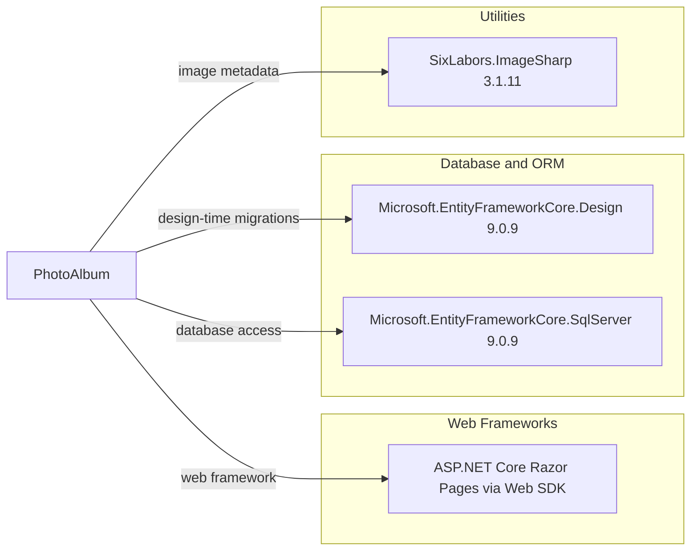

# Dependency Map

PhotoAlbum declares three application package dependencies and six test-project dependencies. The web framework and base class libraries are supplied by the .NET 9 SDK/shared framework.

## Dependencies

### Dependency Summary

| Category | Count | Key Libraries | Notes |
|---|---:|---|---|
| Web Frameworks | 1 | ASP.NET Core Razor Pages | Included through `Microsoft.NET.Sdk.Web`; not a package reference |
| Database / ORM | 2 | EF Core Design 9.0.9, EF Core SQL Server 9.0.9 | Design package is private to the application project |
| Utilities | 1 | SixLabors.ImageSharp 3.1.11 | Reads uploaded image dimensions |

### Version & Compatibility Risks

The application targets `net9.0` and uses EF Core 9.0.9. These versions should be assessed for the requested move to .NET 10; the project currently has no central package management file.

### Notable Observations

- The application stores image data outside the database, so metadata and file storage need coordinated failure handling.
- SQL Server is the only declared relational provider; tests separately use EF Core InMemory.
- No explicit logging, security, observability, or caching packages are declared.

## Test Dependencies

| Framework | Version | Notes |
|---|---:|---|
| coverlet.collector | 6.0.2 | Collects test coverage |
| Microsoft.AspNetCore.Mvc.Testing | 9.0.9 | ASP.NET Core integration-test host |
| Microsoft.EntityFrameworkCore.InMemory | 9.0.9 | In-memory EF Core provider |
| Microsoft.NET.Test.Sdk | 17.12.0 | Test discovery and execution |
| xunit | 2.9.2 | Test framework |
| xunit.runner.visualstudio | 2.8.2 | Visual Studio test adapter |

Total test-scope dependencies: 6

The test project has both unit and integration-testing dependencies and an in-memory persistence provider.
