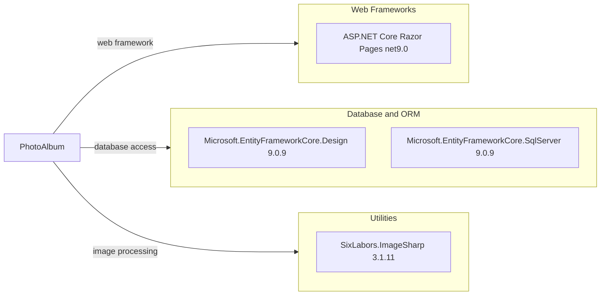

# Dependency Map

PhotoAlbum is a .NET 9 solution with 3 direct application package dependencies and 6 test package dependencies declared in its project files.

## Dependencies

### Dependency Summary

| Category | Count | Key Libraries | Notes |
|---|---:|---|---|
| Web Frameworks | 1 | ASP.NET Core Razor Pages (net9.0) | Provided by the Web SDK and target framework |
| Database and ORM | 2 | Microsoft.EntityFrameworkCore.Design 9.0.9; Microsoft.EntityFrameworkCore.SqlServer 9.0.9 | Design package is private to the application project |
| Utilities | 1 | SixLabors.ImageSharp 3.1.11 | Reads image dimensions during upload |

### Version & Compatibility Risks

Both projects target .NET 9.0 and use EF Core 9.0.9; the selected upgrade-assessment target is .NET 10.0. Package compatibility should be reviewed as part of that upgrade, especially for framework-coupled EF Core and ASP.NET Core packages.

### Notable Observations

- The application has a small direct package set; the project uses the ASP.NET Core Web SDK for its web framework.
- Entity Framework Core Design is marked private to the application project.
- No lock file or central package management file is declared in the solution root, so this map covers direct package references rather than a resolved transitive dependency graph.

## Test Dependencies

| Framework | Version | Notes |
|---|---|---|
| coverlet.collector | 6.0.2 | Code coverage collector |
| Microsoft.AspNetCore.Mvc.Testing | 9.0.9 | ASP.NET Core integration-test hosting support |
| Microsoft.EntityFrameworkCore.InMemory | 9.0.9 | In-memory provider for tests |
| Microsoft.NET.Test.Sdk | 17.12.0 | .NET test execution |
| xunit | 2.9.2 | Test framework |
| xunit.runner.visualstudio | 2.8.2 | Visual Studio test discovery and execution |

Total test-scope dependencies: 6

The test project uses xUnit and ASP.NET Core test hosting with an in-memory EF Core provider. Its test and EF package major versions align with the application's .NET 9/EF Core 9 target.
