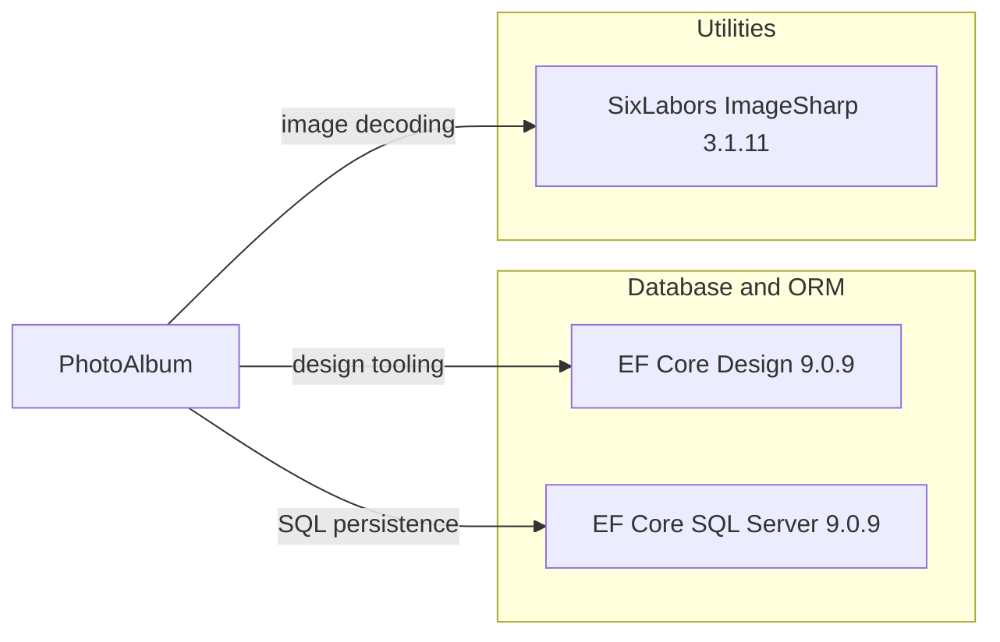

# Dependency Map

PhotoAlbum declares 9 direct package dependencies across the application and test projects: 3 production-project dependencies and 6 test dependencies.

## Dependencies

### Dependency Summary

| Category | Count | Key Libraries | Notes |
|---|---:|---|---|
| Database / ORM | 2 | Microsoft.EntityFrameworkCore.Design 9.0.9; Microsoft.EntityFrameworkCore.SqlServer 9.0.9 | EF Core SQL Server provider and design-time tooling |
| Utilities | 1 | SixLabors.ImageSharp 3.1.11 | Image parsing and dimension extraction |

### Version & Compatibility Risks

The application targets .NET 9 and uses EF Core 9. The dependency assessment found the declared ImageSharp 3.1.11 version affected by high-severity advisories; the advisory data identifies 4.1.2 as the first patched version for those issues. The .NET 10 upgrade assessment also recommends updating EF Core packages to 10.0.13.

### Notable Observations

- ImageSharp is used to parse user-supplied image data and has high-severity dependency advisories at the declared version.
- EF Core design tooling is private to the application project and is not intended as a runtime dependency.
- No central package management file or committed package lock file was identified.

## Test Dependencies

| Framework | Version | Notes |
|---|---:|---|
| coverlet.collector | 6.0.2 | Test coverage collector |
| Microsoft.AspNetCore.Mvc.Testing | 9.0.9 | ASP.NET Core test host |
| Microsoft.EntityFrameworkCore.InMemory | 9.0.9 | In-memory database provider for tests |
| Microsoft.NET.Test.Sdk | 17.12.0 | .NET test runner integration |
| xunit | 2.9.2 | Unit test framework |
| xunit.runner.visualstudio | 2.8.2 | Visual Studio test adapter |

Total test-scope dependencies: 6

Unit tests use xUnit with an EF Core in-memory database and temporary file storage. The .NET upgrade assessment flags the xUnit package as deprecated.
