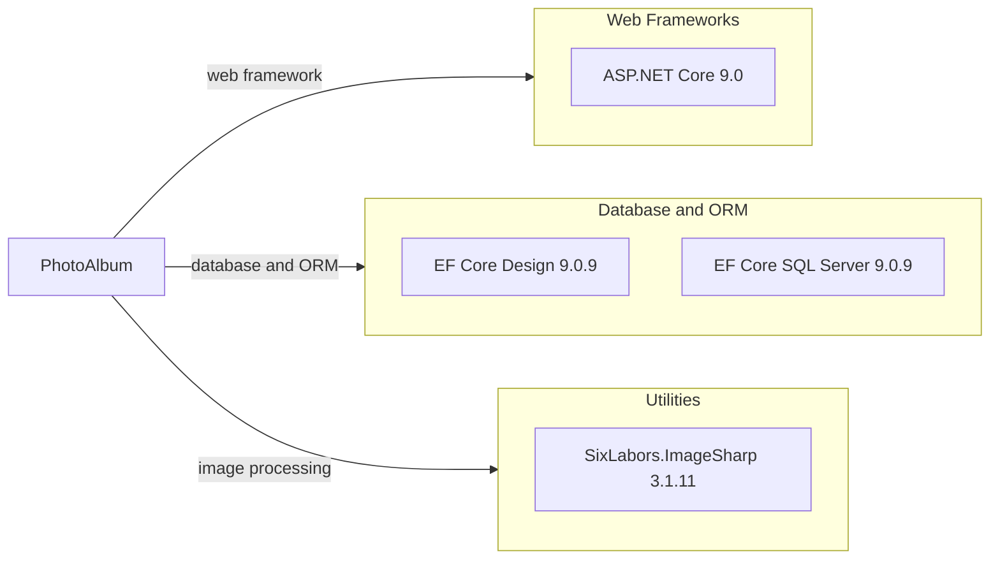

# Dependency Map

PhotoAlbum declares three application package dependencies and six test-scope package dependencies across its two .NET projects.

## Dependencies

### Dependency Summary

| Category | Count | Key Libraries | Notes |
|---|---:|---|---|
| Web Frameworks | 1 | ASP.NET Core 9.0 | Supplied through the Web SDK and target framework |
| Database and ORM | 2 | EF Core Design 9.0.9, EF Core SQL Server 9.0.9 | Design package is private to the application project |
| Utilities | 1 | SixLabors.ImageSharp 3.1.11 | Image metadata and dimension extraction |

### Version & Compatibility Risks

Both application projects target .NET 9 and Entity Framework Core 9. The AppCAT upgrade assessment identified .NET API behavioral/binary compatibility issues and package upgrade recommendations for a .NET 10 target; validate each direct dependency against the selected target before upgrading.

### Notable Observations

- The declared application package set is small and focused on SQL Server persistence and image processing.
- EF Core Design is marked `PrivateAssets=all`, so it is not exposed as a downstream dependency.
- No separate logging, caching, messaging, or observability packages are declared.

## Test Dependencies

| Framework | Version | Notes |
|---|---|---|
| coverlet.collector | 6.0.2 | Collects code coverage during test runs |
| Microsoft.AspNetCore.Mvc.Testing | 9.0.9 | ASP.NET Core integration-test host |
| Microsoft.EntityFrameworkCore.InMemory | 9.0.9 | In-memory EF Core provider for tests |
| Microsoft.NET.Test.Sdk | 17.12.0 | .NET test runner integration |
| xunit | 2.9.2 | Test framework |
| xunit.runner.visualstudio | 2.8.2 | Visual Studio test adapter |

Total test-scope dependencies: 6

The test project includes an ASP.NET Core integration-test host and an in-memory database provider, enabling tests without a local SQL Server instance.
