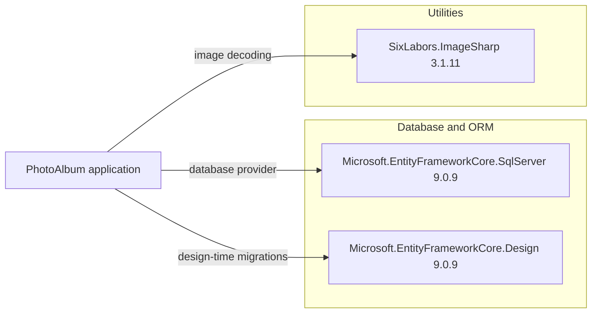

# Dependency Map

PhotoAlbum declares 9 direct NuGet package references across its application and test projects. The application uses three direct packages; six additional packages support testing.

## Dependencies

### Dependency Summary

| Category | Count | Key Libraries | Notes |
|---|---:|---|---|
| Database / ORM | 2 | Microsoft.EntityFrameworkCore.SqlServer 9.0.9; Microsoft.EntityFrameworkCore.Design 9.0.9 | SQL Server provider and design-time migration support |
| Utilities | 1 | SixLabors.ImageSharp 3.1.11 | Image dimension extraction |

### Version & Compatibility Risks

Both projects target `net9.0`; .NET 9 is out of support as of October 2026. Entity Framework Core is pinned at 9.0.9. The direct ImageSharp 3.1.11 dependency is within the affected ranges of six GitHub Security Advisories returned by the dependency scan; the merged security report lists those advisories and their severities. The separate .NET upgrade assessment evaluates `net10.0`.

### Notable Observations

- `Microsoft.EntityFrameworkCore.Design` is marked private to the application project and is used for design-time tooling.
- The test project uses EF Core InMemory rather than SQL Server for its unit tests.
- ImageSharp is a security-sensitive parser for user-uploaded file content.

## Test Dependencies

| Framework | Version | Notes |
|---|---:|---|
| Microsoft.AspNetCore.Mvc.Testing | 9.0.9 | ASP.NET Core integration-test hosting support |
| Microsoft.EntityFrameworkCore.InMemory | 9.0.9 | In-memory EF Core provider |
| Microsoft.NET.Test.Sdk | 17.12.0 | Test execution infrastructure |
| xunit | 2.9.2 | Unit-test framework |
| xunit.runner.visualstudio | 2.8.2 | Visual Studio test discovery and execution |
| coverlet.collector | 6.0.2 | Test coverage collection |

Total test-scope dependencies: 6

The test project uses xUnit and an in-memory database for service-level tests. The project references ASP.NET Core test hosting, though the visible test file exercises `PhotoService` directly.
