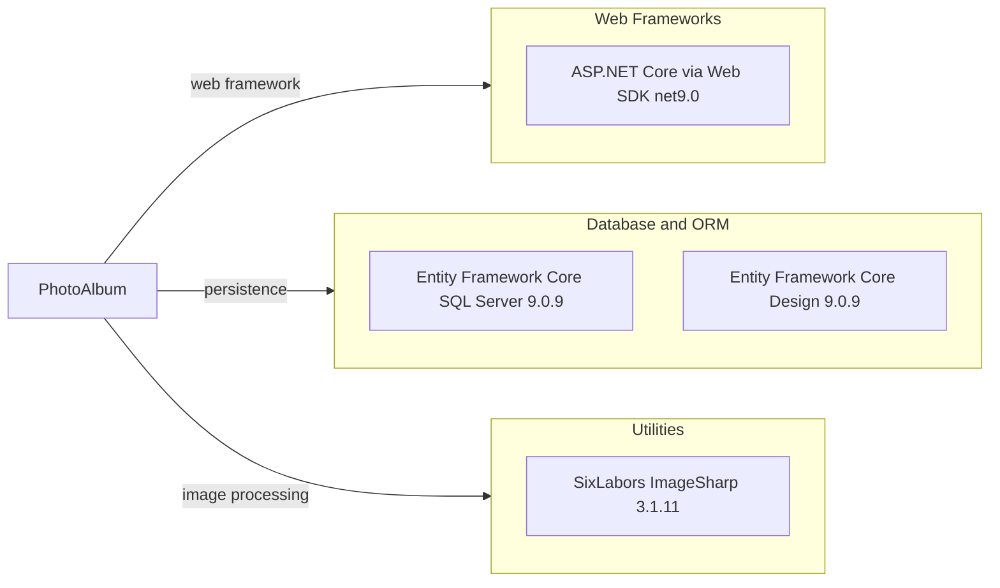

# Dependency Map

PhotoAlbum is a .NET solution with three explicitly declared production dependencies and six test-scope dependencies across its application and test projects.

## Dependencies

### Dependency Summary

| Category | Count | Key Libraries | Notes |
|---|---:|---|---|
| Web Frameworks | 1 | ASP.NET Core Web SDK (`net9.0`) | Framework is supplied by the SDK rather than an explicit package reference |
| Database and ORM | 2 | Entity Framework Core SQL Server 9.0.9; EF Core Design 9.0.9 | Design package is private to the application project |
| Utilities | 1 | SixLabors.ImageSharp 3.1.11 | Used for image inspection |

### Version & Compatibility Risks

The projects target .NET 9.0, while the requested upgrade assessment target is .NET 10.0. The installed NuGet audit reports multiple moderate and high severity advisories for SixLabors.ImageSharp 3.1.11; its version should be evaluated as part of dependency maintenance.

### Notable Observations

- Entity Framework Core packages align on version 9.0.9.
- The production application explicitly references ImageSharp, which the build reports as having known security advisories.
- No central package management file is declared; package versions are specified directly in the project files.

## Test Dependencies

| Framework | Version | Notes |
|---|---|---|
| coverlet.collector | 6.0.2 | Coverage collection |
| Microsoft.AspNetCore.Mvc.Testing | 9.0.9 | ASP.NET Core integration-test hosting |
| Microsoft.EntityFrameworkCore.InMemory | 9.0.9 | In-memory EF Core provider for tests |
| Microsoft.NET.Test.Sdk | 17.12.0 | Test execution infrastructure |
| xunit | 2.9.2 | Test framework |
| xunit.runner.visualstudio | 2.8.2 | Visual Studio test adapter |

Total test-scope dependencies: 6

The test project uses xUnit with ASP.NET Core test hosting and EF Core InMemory. Test package versions are generally aligned with the application framework, while test execution is provided by Microsoft.NET.Test.Sdk.
