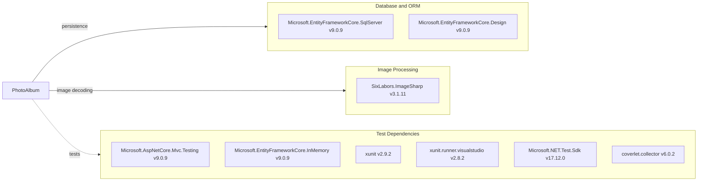

# Dependency Map

PhotoAlbum has three application package references and six test-project package references (nine declared package references across the solution).

## Dependencies

### Dependency Summary

| Category | Count | Key Libraries | Notes |
|---|---:|---|---|
| Database and ORM | 2 | EF Core SQL Server 9.0.9, EF Core Design 9.0.9 | Design package is private to the application project |
| Image Processing | 1 | SixLabors.ImageSharp 3.1.11 | Reads dimensions from uploaded images |
| Test Dependencies | 6 | ASP.NET Core MVC Testing, EF Core InMemory, xUnit, Test SDK, Coverlet | Used only by `PhotoAlbum.Tests` |

### Version & Compatibility Risks

Both projects target .NET 9.0. The requested .NET 10.0 assessment reports target-framework changes and package/API compatibility items. ImageSharp 3.1.11 is affected by five GitHub Security Advisories at or above the requested medium threshold; the advisories identify ImageSharp 4.1.2 as the first patched release for these findings.

### Notable Observations

- The application references EF Core SQL Server and EF Core Design at the same 9.0.9 version.
- ImageSharp processes untrusted uploads and has multiple applicable security advisories for the resolved version.
- The test project uses the in-memory EF Core provider instead of a SQL Server test instance.

## Test Dependencies

| Framework | Version | Notes |
|---|---|---|
| Microsoft.AspNetCore.Mvc.Testing | 9.0.9 | ASP.NET Core integration-test host |
| Microsoft.EntityFrameworkCore.InMemory | 9.0.9 | In-memory database provider used by service tests |
| xunit | 2.9.2 | Test framework |
| xunit.runner.visualstudio | 2.8.2 | Visual Studio test adapter |
| Microsoft.NET.Test.Sdk | 17.12.0 | .NET test runner infrastructure |
| coverlet.collector | 6.0.2 | Coverage data collector |

Total test-scope dependencies: 6

The test project has both unit and ASP.NET Core integration-testing dependencies. The primary service tests isolate persistence with EF Core InMemory.
