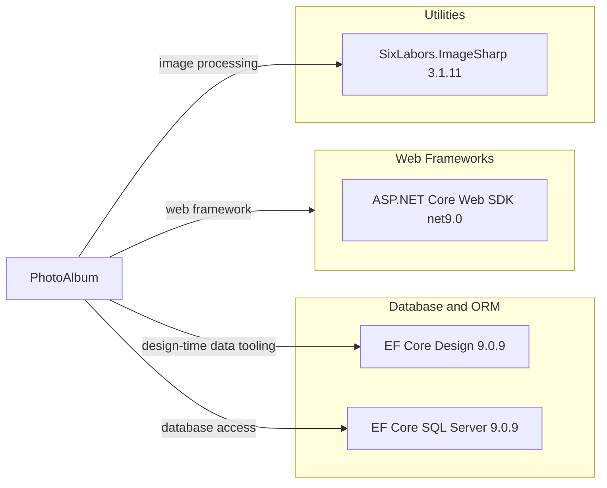

# Dependency Map

PhotoAlbum declares 9 NuGet package references across its application and test projects. The application diagram below includes the three production-project package references; test-only packages are listed separately.

## Dependencies

### Dependency Summary

| Category | Count | Key Libraries | Notes |
|---|---:|---|---|
| Web Frameworks | 1 | ASP.NET Core Web SDK, net9.0 | Supplied by the .NET SDK/shared framework |
| Database and ORM | 2 | EF Core Design 9.0.9, EF Core SQL Server 9.0.9 | Design package is private to the project |
| Utilities | 1 | SixLabors.ImageSharp 3.1.11 | Image dimension extraction |

### Version & Compatibility Risks

Both projects target `net9.0`; the EF Core packages are on 9.0.9. A move to .NET 10 should align the EF Core packages with a compatible major version and validate ImageSharp compatibility before changing the target framework.

### Notable Observations

- EF Core Design is marked `PrivateAssets=all` and is used for design-time tooling rather than as a downstream package dependency.
- The application references SQL Server EF Core; tests separately reference EF Core InMemory.
- No centralized package version management file is present in the inspected solution.

## Test Dependencies

| Framework | Version | Notes |
|---|---|---|
| Microsoft.AspNetCore.Mvc.Testing | 9.0.9 | ASP.NET Core integration-test host |
| Microsoft.EntityFrameworkCore.InMemory | 9.0.9 | In-memory EF Core provider |
| Microsoft.NET.Test.Sdk | 17.12.0 | .NET test host |
| xunit | 2.9.2 | Test framework |
| xunit.runner.visualstudio | 2.8.2 | Visual Studio test adapter |
| coverlet.collector | 6.0.2 | Coverage collector |

Total test-scope dependencies: 6

The test project uses xUnit and ASP.NET Core's integration-test host, with an in-memory database provider. The declared package versions target the same .NET 9 / EF Core 9 baseline as the application.
