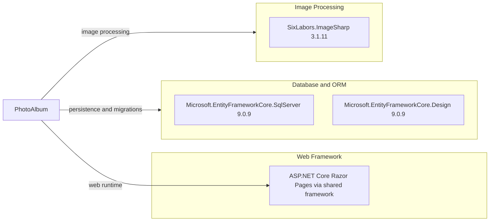

# Dependency Map

PhotoAlbum is a two-project .NET solution with 9 explicitly declared package references (3 application dependencies and 6 test dependencies).

## Dependencies

### Dependency Summary

| Category | Count | Key Libraries | Notes |
|---|---:|---|---|
| Web Framework | 0 direct package references | ASP.NET Core Razor Pages | Provided by `Microsoft.NET.Sdk.Web` and the shared framework |
| Database / ORM | 2 | EF Core SQL Server 9.0.9, EF Core Design 9.0.9 | Design package is private to the project |
| Image Processing | 1 | SixLabors.ImageSharp 3.1.11 | Used for image dimension extraction |

### Version & Compatibility Risks

The application and its EF Core packages target .NET 9. The .NET 9 support window is nearing its end in November 2026, so the selected framework version will soon require an upgrade for continued support. The security assessment separately reports applicable dependency advisories.

### Notable Observations

- The application has three direct package references; ASP.NET Core itself is supplied by the shared framework rather than a direct package.
- The SQL Server provider and EF Core Design package use matching 9.0.9 versions.
- The test project has its own in-memory EF provider and test-runner dependencies, listed separately below.

## Test Dependencies

| Framework | Version | Notes |
|---|---|---|
| coverlet.collector | 6.0.2 | Code coverage collector |
| Microsoft.AspNetCore.Mvc.Testing | 9.0.9 | ASP.NET Core integration-test host |
| Microsoft.EntityFrameworkCore.InMemory | 9.0.9 | In-memory database provider for tests |
| Microsoft.NET.Test.Sdk | 17.12.0 | Test execution infrastructure |
| xunit | 2.9.2 | Test framework |
| xunit.runner.visualstudio | 2.8.2 | Visual Studio test adapter |

Total test-scope dependencies: 6

The solution uses xUnit with ASP.NET Core integration testing and an in-memory EF Core database. No separate contract-testing or container-based database dependency is declared.
