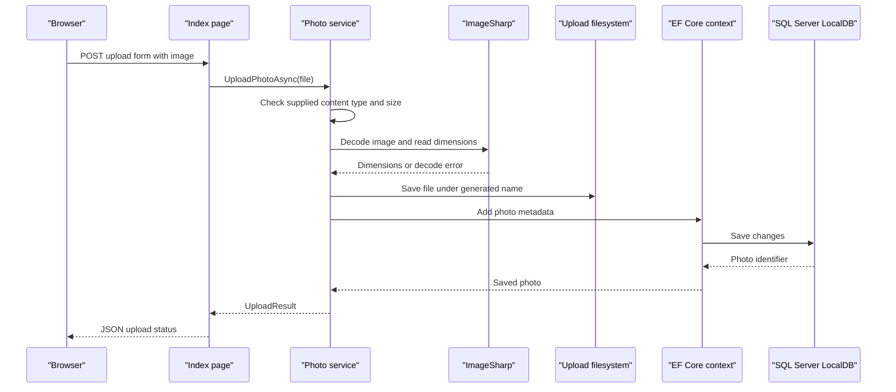

# API & Service Communication Contracts

The application exposes server-rendered Razor Pages and page handlers rather than a versioned REST API. Requests and photo operations are synchronous within one application process; no inter-service messaging or remote service calls were identified.

## Service Catalog

| Service | Port | Category | Purpose |
|---|---|---|---|
| PhotoAlbum | 5134 HTTP; 7055 HTTPS in the development launch profile | API Layer | Razor Pages photo gallery, upload, retrieval, and deletion |

## API Endpoints Inventory

| Service | Method | Path | Request Type | Response Type |
|---|---|---|---|---|
| PhotoAlbum | GET | `/` | None | Gallery HTML |
| PhotoAlbum | POST | `/?handler=Upload` | Multipart form with `files` (`List<IFormFile>`) and antiforgery token | JSON upload result with success, uploaded items, and failed items |
| PhotoAlbum | GET | `/Detail/{id?}` | Optional integer route parameter | Detail HTML or 404 |
| PhotoAlbum | POST | `/Detail/{id}?handler=Delete` | Integer route parameter and antiforgery token | Redirect to gallery, or redirect back with an error |
| PhotoAlbum | GET | `/photo/{id:int}` | Integer route parameter | Image file response or 404 |
| PhotoAlbum | GET | `/Privacy` | None | Privacy HTML |
| PhotoAlbum | GET | `/Error` | None | Error HTML |

The upload handler returns HTTP 400 when no files are supplied. No explicit API versioning scheme is configured.

## Management & Observability Endpoints

| Service | Endpoint | Custom Metrics |
|---|---|---|
| PhotoAlbum | No health-check, metrics, or Swagger endpoint was identified | None identified |

## DTOs & Contracts

`IFormFile` is the upload request type. `UploadResult` is the service-level operation result, while the upload page handler emits an anonymous JSON response containing upload status and per-file outcomes. `Photo` is the persistence entity used to provide photo metadata; it is not an immutable API DTO. ASP.NET Core uses its default `System.Text.Json` serialization for the JSON result. No OpenAPI/Swagger document, protobuf schema, GraphQL schema, or API-specific DTO layer was found.

## Communication Patterns

All communication is synchronous: the browser makes HTTP requests to Razor Pages, which invoke the scoped `IPhotoService` directly. The service interacts with EF Core and the local filesystem; there are no message brokers, service discovery, gateway aggregation, retry policies, circuit breakers, or configured timeouts for downstream services. The application redirects HTTP to HTTPS and uses antiforgery tokens on the upload and delete forms. No authentication or authorization policy is configured, so the pages and operations have no application-level user/role access checks.

## Service Technology Matrix

| Service | Web | Data Access | Discovery | Gateway | Health | Cache | Metrics |
|---|---|---|---|---|---|---|---|
| PhotoAlbum | Razor Pages | EF Core SQL Server | None | None | None | Response cache headers on photo files | None |

## Service Communication Sequence

