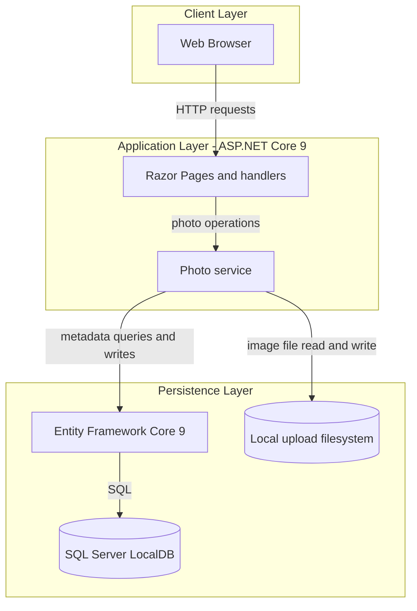
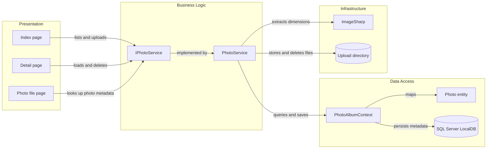

# Architecture Diagram

PhotoAlbum is a single ASP.NET Core Razor Pages application. It handles photo uploads and browsing in-process, storing metadata in SQL Server LocalDB and image files on the local filesystem.

## Application Architecture

### Technology Stack Summary

| Layer | Technology | Version | Purpose |
|---|---|---:|---|
| Presentation | ASP.NET Core Razor Pages | 9.0 | Server-rendered gallery, detail, and upload pages |
| Business logic | .NET | 9.0 target | Photo upload, retrieval, and deletion operations |
| Persistence | Entity Framework Core SQL Server provider | 9.0.9 | Photo metadata persistence |
| Image processing | SixLabors.ImageSharp | 3.1.11 | Image decoding and dimension extraction |
| Database | SQL Server LocalDB | Local development configuration | Stores photo metadata |
| File storage | Local filesystem | N/A | Stores uploaded image files under `wwwroot/uploads` |

### Data Storage & External Services

Photo metadata is stored in a SQL Server database configured as LocalDB. Image bytes are stored separately on the local filesystem, and the application does not call external services or use a remote cache, message broker, or object-storage provider.

### Key Architectural Decisions

- A scoped `IPhotoService` separates page handlers from photo operations and storage details.
- Entity Framework Core migrations manage the single `Photos` table.
- File and database operations are coordinated in the service, with uploaded files removed when metadata persistence fails.

## Component Relationships

### Component Inventory

| Component | Layer | Type | Responsibility |
|---|---|---|---|
| Index page | Presentation | Razor Page | Displays the gallery and accepts uploads |
| Detail page | Presentation | Razor Page | Displays one photo, navigation, and deletion controls |
| Photo file page | Presentation | Razor Page | Retrieves stored photo bytes by identifier |
| IPhotoService | Business Logic | Service interface | Defines photo listing, lookup, upload, and deletion operations |
| PhotoService | Business Logic | Scoped service | Validates uploads and coordinates image, filesystem, and database operations |
| PhotoAlbumContext | Data Access | EF Core DbContext | Maps and persists photo metadata |
| Photo | Data Access | Entity | Represents photo metadata |
| ImageSharp | Infrastructure | Image-processing library | Reads image dimensions during upload |
| Upload directory | Infrastructure | Filesystem storage | Holds uploaded image files |
