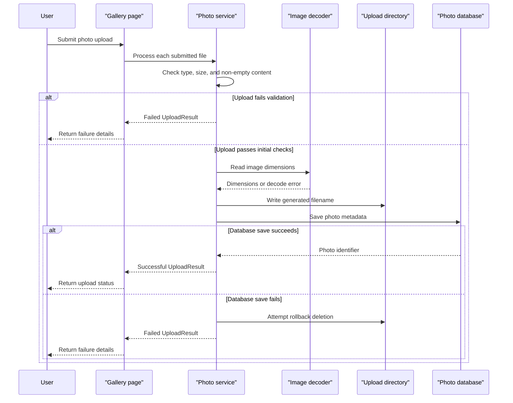

# Core Business Workflows

PhotoAlbum lets users upload, browse, inspect, and delete photos. Each photo is represented by metadata in the application database and an image file in the local upload directory.

## Domain Entities

| Entity | Service / Bounded Context | Description | Key Relationships |
|---|---|---|---|
| Photo | PhotoAlbum / Photo Gallery | An uploaded image and its display and storage metadata | No other domain entities; references its stored file by generated filename/path |

## Service-to-Domain Mapping

| Service | Domain Context | Owned Entities | External Dependencies |
|---|---|---|---|
| PhotoAlbum | Photo Gallery | Photo | SQL Server LocalDB and local filesystem are application-managed persistence resources, not other services |

## Primary Workflows

### Workflow 1: Upload Photos

The user submits one or more files from the gallery page. The page handler rejects an empty file collection, then calls `PhotoService` for each file. The service checks the supplied MIME type, configured maximum byte count, and non-empty length; it generates a unique stored filename, attempts to decode the content to obtain dimensions, writes the file, and saves metadata. A database-save failure triggers a best-effort file deletion. The handler returns JSON containing successes and failures.

The page uses antiforgery validation. The UI permits selecting multiple files and the configuration includes a maximum-file-count setting, but no enforcement of that setting was identified in the page handler.

### Workflow 2: Browse and View a Photo

The gallery page loads metadata ordered by upload date. A selected photo detail page resolves its metadata and neighboring photo identifiers. The photo-file page looks up the record, derives the stored filename, reads bytes from the upload directory, and returns them with the stored MIME type.

### Workflow 3: Delete a Photo

The detail page submits an antiforgery-protected delete form. `PhotoService` loads the metadata, attempts to delete the stored file, then removes the database record. If file deletion fails, the error is logged and database deletion proceeds.

## Cross-Service Data Flows

No cross-service data composition exists. The single application coordinates metadata and filesystem content within the same service. If saving the database record fails after the file is written, the service attempts compensating file deletion; deletion of the metadata continues even when physical file deletion fails.

## Business Workflow Sequence

## Business Rules & Decision Logic

- The upload service accepts only configured MIME types and rejects empty files or files exceeding the configured byte limit. The current MIME check uses the client-supplied content type.
- Stored filenames are generated from a GUID and the uploaded filename extension; the original name remains metadata for display.
- Image dimension extraction is best-effort: a decoding exception is logged, and the upload path continues without dimensions.
- Metadata persistence is attempted after writing the file; failed metadata persistence triggers best-effort rollback of the file.
- The upload handler enforces a total multipart request body limit through ASP.NET Core form options. A configured `MaxFilesPerUpload` value was not found to be enforced by the handler.
- Deletion has no explicit lifecycle state or authorization rule. The metadata record is removed even if physical file deletion fails.
- No transaction spans the database and filesystem. File cleanup is a compensating action; no audit trail or business-event log is configured.
