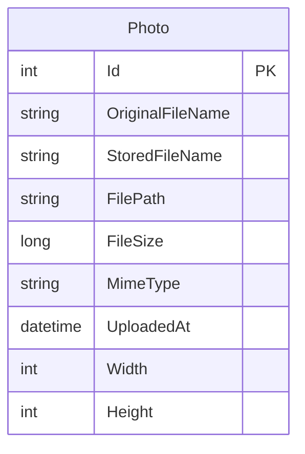

# Data Architecture & Persistence Layer

The data layer contains one EF Core entity backed by SQL Server and a local filesystem store for image bytes. EF Core migrations define the metadata schema; no separate repository implementation or database cache is present.

## Database Configuration

| Service/Module | DB Type | Profile | Driver | Connection | Migration Tool |
|---|---|---|---|---|---|
| PhotoAlbum | SQL Server LocalDB | Default/local development | EF Core SQL Server provider 9.0.9 | `DefaultConnection` in `appsettings.json` | EF Core migrations |
| PhotoAlbum.Tests | EF Core InMemory | Test | EF Core InMemory 9.0.9 | In-memory provider configured in tests | None |

The application applies pending EF Core migrations during startup except when `IsTestEnvironment` is true. The initial migration creates the photo metadata table and an index on upload time.

## Data Ownership per Service

| Service | Tables Owned | ORM Framework | Caching | Notes |
|---|---|---|---|---|
| PhotoAlbum | `Photos` | Entity Framework Core 9 | No data cache | Stores metadata in SQL Server and image bytes in the local upload directory |

## Entity Model

The `Photo` entity is defined in `PhotoAlbum/Models/Photo.cs`. Its metadata includes an integer identifier, original and generated filenames, a relative file path, byte count, MIME type, UTC upload timestamp, and optional image dimensions. The entity has no foreign-key relationships or navigation properties.

## Key Repository Methods

| Service | Repository | Notable Methods | Purpose |
|---|---|---|---|
| PhotoAlbum | `PhotoAlbumContext` (`PhotoAlbum/Data/PhotoAlbumContext.cs`) | `Photos.OrderByDescending(UploadedAt)`, `Photos.FindAsync(id)`, `Photos.AddAsync`, `SaveChangesAsync`, `Remove` | Lists, looks up, inserts, and deletes metadata. These operations are called by `PhotoService`; there is no separate repository interface. |

## Caching Strategy

No data or query-result cache is configured. The photo-file page sets a one-year HTTP `Cache-Control` header and an ETag for returned image responses; this is browser/proxy response caching rather than a database cache.

## Data Ownership Boundaries

The application is a single deployable service with a single metadata database and a local filesystem directory. There are no cross-service reads, shared database consumers, CQRS projections, or inter-service aggregation paths. `PhotoService` coordinates metadata operations through the DbContext and image bytes through the filesystem.

### Data Classification & Sensitivity

| Entity | Sensitive Fields | Classification (PII/PHI/PCI/None) | Controls in Place |
|---|---|---|---|
| Photo | Original filename and uploaded image content may contain identifying or sensitive personal information | Potential PII/PHI | No field-level encryption, masking, or application-configured encryption at rest was identified |

